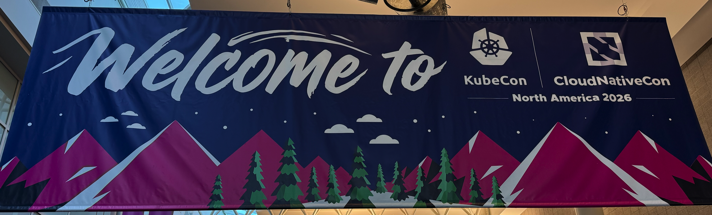
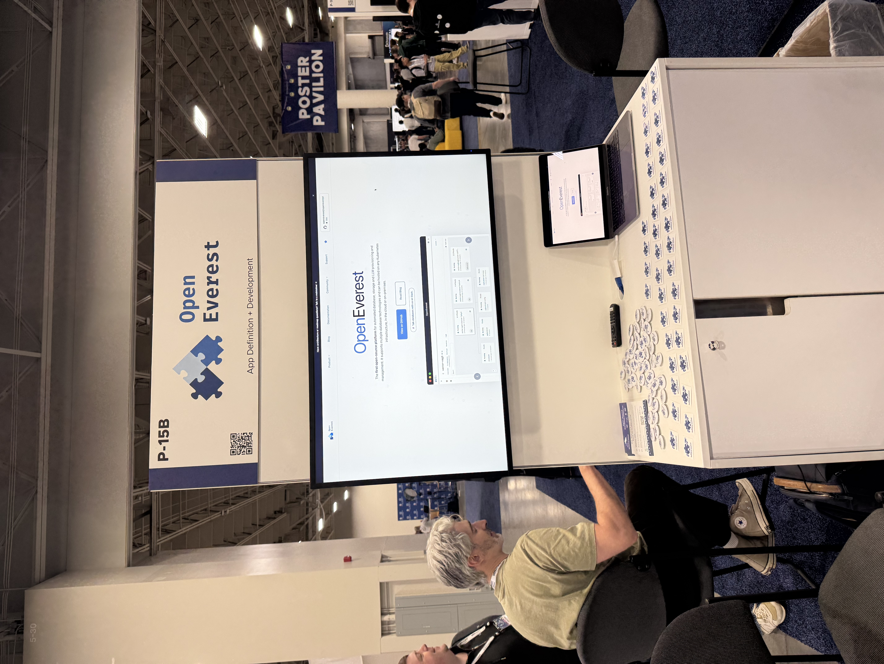
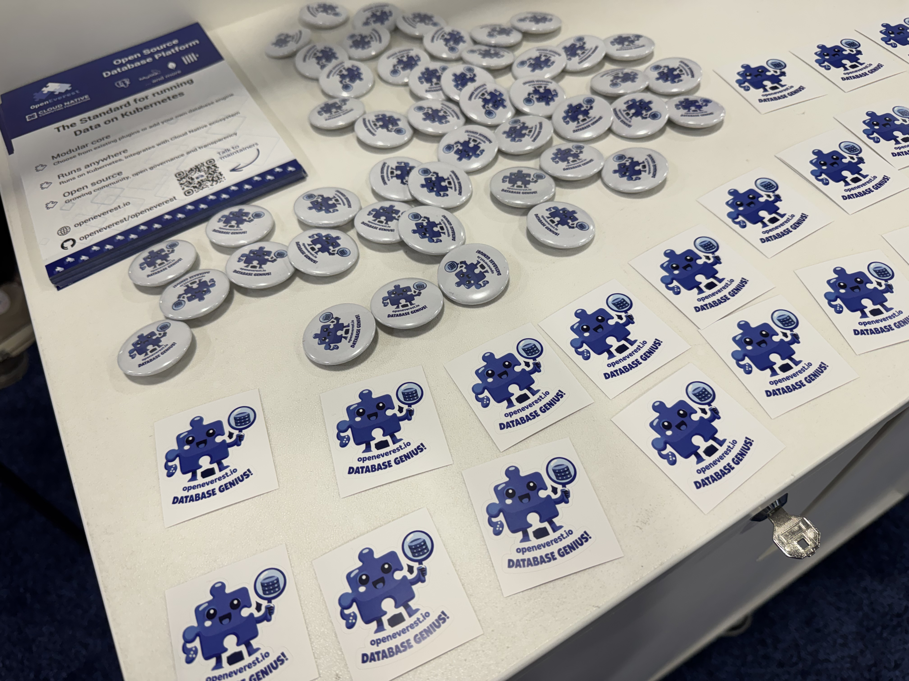

OpenEverest was present at KubeCon + CloudNativeCon North America 2026, held in Salt Lake City, Utah, USA on November 9–12. The project was represented by Marcin Gwóźdź, one of the maintainers, and community friends from Percona.

The event was intense, crowded, and packed with people ready to talk about cloud native use cases and technologies. During the four days, we had a project lightning talk on the first day, a project booth in the project pavilion on Wednesday, and plenty of interesting conversations around OpenEverest technology.

Attendees who were stopping by the booth could learn about:

* OpenEverest roadmap — recently released 4th Developer Preview and scheduled next steps allowing GA by the end of the year
* Running PostgreSQL, MySQL, MongoDB, ClickHouse, Valkey, TiDB, MS SQL and others on Kubernetes with a single control plane
* Backups, restores, and point-in-time recovery across database engines
* Contributing to OpenEverest
* See OpenEverest demo

The outcome?

We’re seeing increasing interest in running databases on Kubernetes! Several discussions were about running private DBaaS, building sovereignty products, and providing internal platforms for developers. Surprisingly, we saw interest in implementing OpenEverest directly on OpenStack, even though the event was fully focused on Kubernetes.

Conclusion:

Our team had some great conversations about the software, and we hope to go back next year! AI, besides data sovereignty, is a big topic in the Kubernetes world, and providing fully open source technologies allows you to avoid vendor lock-in, securing your interests. 

**You didn’t manage to be at KubeCon, but you want to connect?**
* [Star the project on GitHub](https://github.com/openeverest/openeverest)
* [Join the conversation on our community channels](https://cloud-native.slack.com/archives/C09RRGZL2UX)
* [Follow us on LinkedIn](https://www.linkedin.com/company/openeverest/)
* [Browse other upcoming events](https://openeverest.io/resources/)