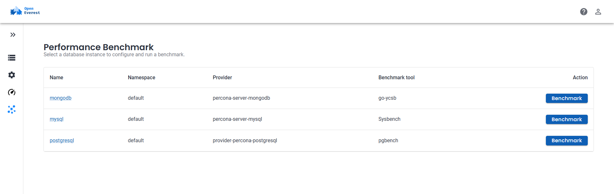
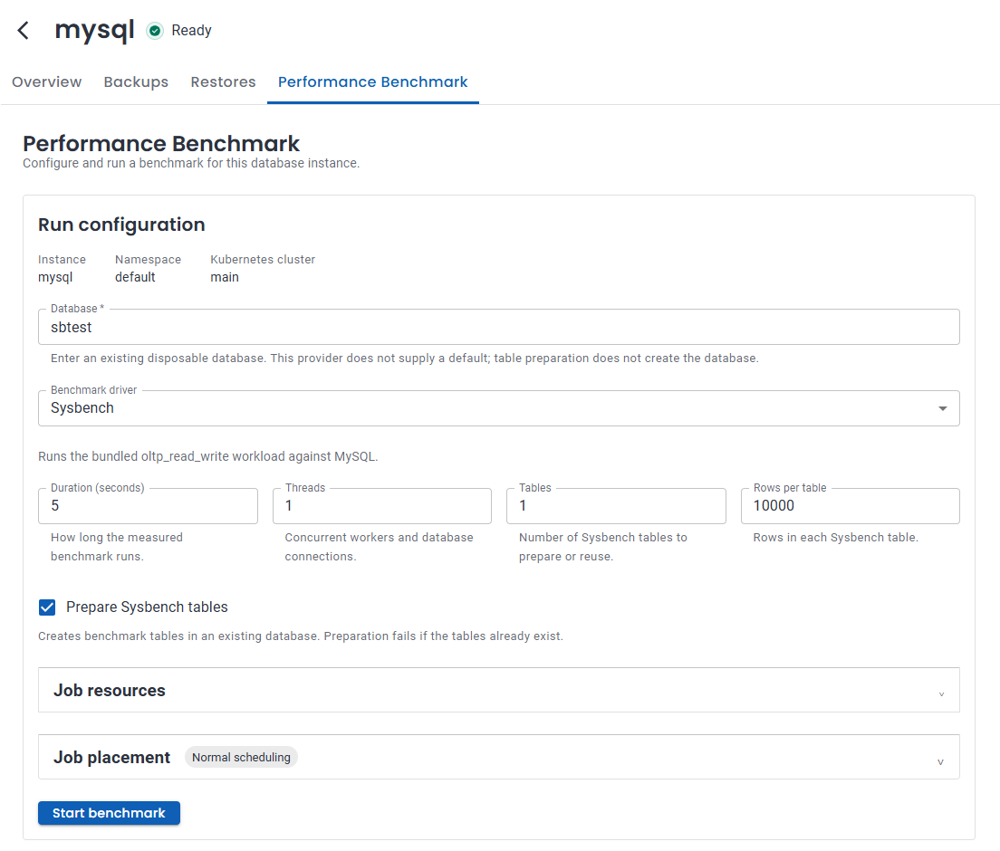
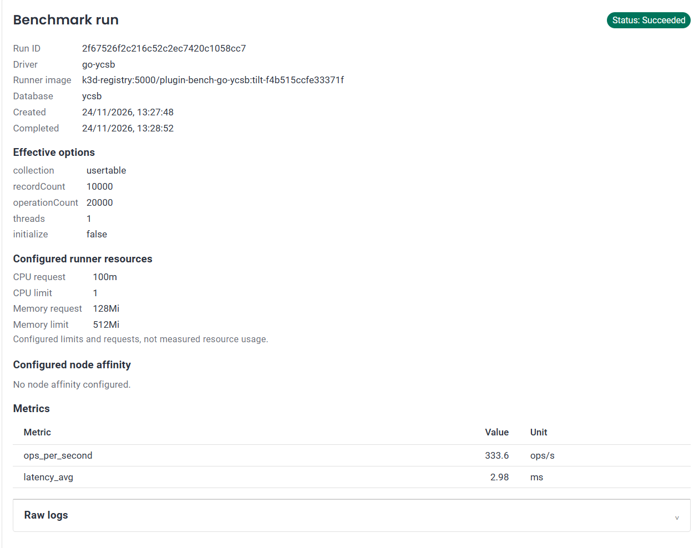
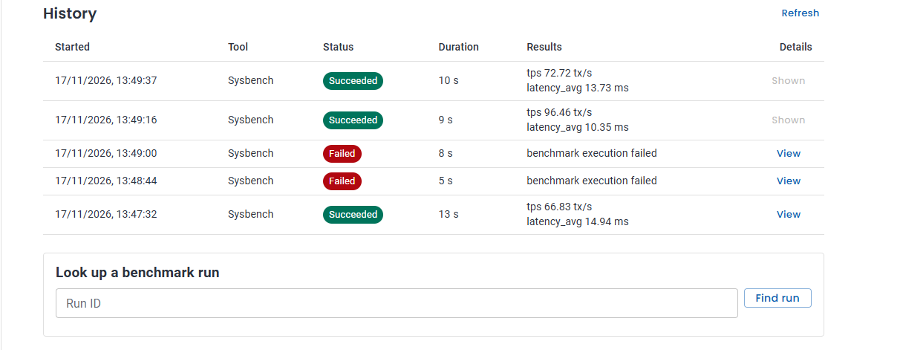

Your database is running. How does it respond under load? Whether you are exploring a new deployment or checking the effect of a configuration change, a benchmark can provide a useful starting point.

Plugin Bench is a **database-agnostic, extensible benchmarking plugin for OpenEverest**. Its driver system lets contributors add database integrations and benchmark tools, all using a shared workflow for configuring tests, inspecting results, and reviewing previous runs. You can benchmark supported instances from the same interface you use to manage them, without assembling a separate command-line workflow.

## One benchmarking interface, extensible by design

A driver connects a benchmark tool to a database technology and handles its specific test options and results. Additional drivers extend the plugin while reusing its run execution and history features. **Support for more databases is coming soon.**

The Performance Benchmark page brings supported instances together in one place, showing each instance, its namespace, and its benchmark tool. You can also open the Performance Benchmark tab directly on an instance.

*Discover instances and their benchmark tools in one place (PostgreSQL/pgbench, MySQL/Sysbench, and MongoDB/go-ycsb examples).*

Each integration provides a workload—the mix of operations a benchmark performs—suited to its benchmark tool. The integrations available today include:

- **PostgreSQL with pgbench:** runs the standard built-in transaction workload.
- **MySQL with Sysbench:** runs an OLTP read/write workload, exercising a mix of reads and writes.
- **MongoDB with go-ycsb:** runs Workload A, configured for 50% reads and 50% updates.

The tools offered for an instance depend on its supported provider and the drivers enabled by your administrator.

## Control the workload from the UI

The benchmark form exposes the settings relevant to the selected tool. You can adjust concurrency and dataset size, choose how much work to perform, and prepare fresh benchmark data or reuse an existing dataset.

Depending on the benchmark tool, you can specify a measured duration or an operation count. Each driver exposes the controls its tool needs while sharing the same configuration and run workflow. This keeps the experience familiar as new integrations are added.

*Tailor the workload to your test, shown here with MySQL and Sysbench.*

Optional CPU and memory settings control the benchmark workload generator. Node affinity lets users select runner nodes by label, while administrators can configure tolerations through Helm to allow runners onto tainted nodes, such as a dedicated benchmark node pool. These settings do not change the database instance’s resources or placement. Connection details come through OpenEverest, so there is no database password field to fill in before each run.

Use disposable test data: benchmarks generate real database load, and preparation creates or modifies benchmark datasets. Those datasets remain available afterward for reuse.

## Inspect results without digging through logs

Completed runs can report throughput and average latency alongside the settings used. Throughput shows how much work the database completes per second, while average latency shows how long an operation takes. Throughput is reported in transactions or operations per second, depending on the benchmark tool.

Each result card also records the run’s status and effective workload settings. Expandable **Raw logs** provide the underlying tool output, helping you investigate a failed run or check that a completed run used the configuration you intended. If metrics are unavailable, you can still inspect the status and logs.

*Review settings alongside throughput and latency, shown here with MongoDB and go-ycsb.*

Measurements such as throughput and latency depend on the tool, dataset, resources, and other activity in the environment. The screenshots show local demonstration runs; your results may differ. Use repeated runs with consistent settings to explore your own deployment, and interpret results within the same workload rather than treating different tools as a ranking of databases.

## Return to earlier runs

Each instance has its own recent benchmark history. The list displays its 20 most recent runs, showing when a run started, its tool, status, elapsed duration, and available results. You can reopen previous run details to review their settings and output.

*Revisit earlier settings and outcomes to plan your next test, shown here with MySQL and Sysbench.*

History includes failed runs as well as successful ones, keeping their outcomes visible for investigation. Its duration represents the overall elapsed time, including startup and preparation, so it can be longer than the measured test period. By default, history is held in memory, disappears on restart, and completed records expire after one hour. For durable history, configure the plugin’s [PostgreSQL storage backend](https://github.com/openeverest/plugin-bench#run-history-storage).

## Try it on a test instance

Plugin Bench extends OpenEverest v2 with database benchmarking. This introduction covers Plugin Bench **v0.3.0**. See the [Plugin Bench repository](https://github.com/openeverest/plugin-bench) for requirements and installation details.

For MySQL, provide an existing disposable database. The included go-ycsb version currently benchmarks only the `ycsb` MongoDB database, and the instance credentials need read/write access to it.

Start with a small workload on a test instance and explore the results. The plugin’s driver system provides a way to extend this experience with additional database integrations and benchmark tools. Contributions and feedback are welcome: [share your ideas or propose a new integration](https://github.com/openeverest/plugin-bench/issues).
