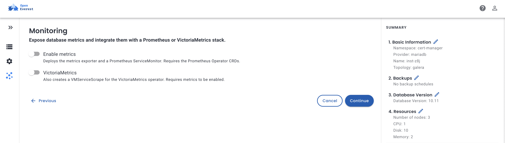
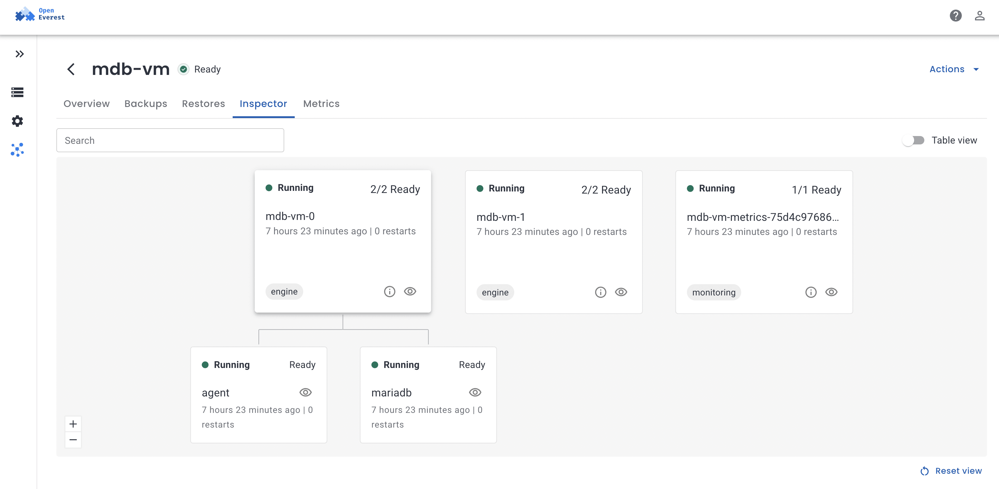

[`provider-mariadb` 0.2.1](https://github.com/openeverest/provider-mariadb/releases/tag/v0.2.1) can now register your databases with the [VictoriaMetrics operator](https://docs.victoriametrics.com/operator/), not only with the Prometheus Operator. It's one more switch when you create a database, and [`plugin-metrics`](https://github.com/openeverest/plugin-metrics) reads the metrics back into the instance page.

In this post I follow a metric from the `Instance` you create to the chart in the UI. Then I scale the whole thing to 50 MariaDB clusters to see what the monitoring itself costs.

## Turning it on

In the create wizard, the **Monitoring** step now has two switches. *Enable metrics* deploys the exporter. *VictoriaMetrics* additionally registers it with the VictoriaMetrics operator.



In the `Instance` spec, that is the `monitoring` component:

```yaml
    monitoring:
      parameters:
        enabled: true
        victoriaMetrics:
          enabled: true
```

## Follow a metric

Six components are involved between the switch and the chart. Click through them:

<div class="vmb-steps">
  <input type="radio" name="vmb-step" id="vmb-s1" checked>
  <input type="radio" name="vmb-step" id="vmb-s2">
  <input type="radio" name="vmb-step" id="vmb-s3">
  <input type="radio" name="vmb-step" id="vmb-s4">
  <input type="radio" name="vmb-step" id="vmb-s5">
  <input type="radio" name="vmb-step" id="vmb-s6">
  <div class="vmb-flow">
    <label for="vmb-s1" data-step="1"><b>1</b>Instance</label>
    <label for="vmb-s2" data-step="2"><b>2</b>mariadb-operator</label>
    <label for="vmb-s3" data-step="3"><b>3</b>VM converter</label>
    <label for="vmb-s4" data-step="4"><b>4</b>Provider</label>
    <label for="vmb-s5" data-step="5"><b>5</b>VMAgent</label>
    <label for="vmb-s6" data-step="6"><b>6</b>VMSingle &amp; UI</label>
  </div>
  <div class="vmb-step" data-step="1">
    <p><strong>You create an Instance</strong> with <code>monitoring.parameters.enabled</code> and <code>victoriaMetrics.enabled</code> set. The provider turns it into a <code>MariaDB</code> resource for mariadb-operator with metrics enabled, and stamps it with OpenEverest's labels.</p>
    <label for="vmb-s2" class="vmb-next">Next: mariadb-operator →</label>
  </div>
  <div class="vmb-step" data-step="2">
    <p><strong>mariadb-operator deploys one <code>mysqld-exporter</code> per cluster.</strong> It's a single Deployment that scrapes every MariaDB server in the cluster, so a 2-node cluster has two database pods and one exporter pod.</p>
    <p>The operator also creates a Prometheus <code>ServiceMonitor</code> for the exporter, and until now it always did. That's why the <code>ServiceMonitor</code> CRD has been required even in clusters without Prometheus. More on that below.</p>
    <label for="vmb-s3" class="vmb-next">Next: VM converter →</label>
  </div>
  <div class="vmb-step" data-step="3">
    <p><strong>The VictoriaMetrics operator converts it.</strong> It watches Prometheus Operator objects and creates a matching <code>VMServiceScrape</code> for each <code>ServiceMonitor</code>. Useful, but the converted object doesn't know anything about OpenEverest.</p>
    <label for="vmb-s4" class="vmb-next">Next: provider →</label>
  </div>
  <div class="vmb-step" data-step="4">
    <p><strong>The provider takes the <code>VMServiceScrape</code> over.</strong> It annotates it with <code>operator.victoriametrics.com/ignore-prometheus-updates</code> so the converter leaves it alone, and adds OpenEverest's labels, including <code>core.openeverest.io/provider: mariadb</code>. There's still exactly one scrape config for the exporter, so nothing is scraped twice.</p>
    <label for="vmb-s5" class="vmb-next">Next: VMAgent →</label>
  </div>
  <div class="vmb-step" data-step="5">
    <p><strong>VMAgent picks up every MariaDB in the cluster</strong> with a single selector on that provider label, in any namespace. It scrapes the exporters every 30 seconds and sends the samples to storage with remote write, buffering them on disk if storage is unavailable.</p>
    <label for="vmb-s6" class="vmb-next">Next: VMSingle and the UI →</label>
  </div>
  <div class="vmb-step" data-step="6">
    <p><strong>VMSingle stores the samples and answers queries</strong> through the same HTTP API Prometheus uses. That's why <code>plugin-metrics</code> needs no special VictoriaMetrics mode: you point its Prometheus source at VMSingle, and the Metrics tab of every MariaDB instance charts queries, connections, threads and traffic.</p>
    <label for="vmb-s1" class="vmb-next">Back to the start ↺</label>
  </div>
</div>

You can see step 2 in the Inspector of any MariaDB instance: two `engine` pods and a single exporter pod next to them, tagged `monitoring`.



## The VictoriaMetrics side

OpenEverest's core Helm chart already installs the VictoriaMetrics operator into `everest-monitoring`. You only add a VMAgent and a storage backend. A VMAgent that picks up every MariaDB in the cluster:

```yaml
apiVersion: operator.victoriametrics.com/v1beta1
kind: VMAgent
metadata:
  name: showcase
  namespace: vm-showcase
spec:
  scrapeInterval: 30s
  selectAllByDefault: false
  serviceScrapeNamespaceSelector: {}
  serviceScrapeSelector:
    matchLabels:
      core.openeverest.io/provider: mariadb
  remoteWrite:
    - url: http://vmsingle-showcase.vm-showcase.svc:8429/api/v1/write
```

And the storage it writes to:

```yaml
apiVersion: operator.victoriametrics.com/v1beta1
kind: VMSingle
metadata:
  name: showcase
  namespace: vm-showcase
spec:
  retentionPeriod: 7d
  storage:
    accessModes: [ReadWriteOnce]
    resources:
      requests:
        storage: 10Gi
```

To chart the metrics on the instance page, point `plugin-metrics` at VMSingle:

```bash
helm upgrade plugin-metrics oci://ghcr.io/openeverest/charts/plugin-metrics \
  -n everest-system \
  --set prometheus.url=http://vmsingle-showcase.vm-showcase.svc:8429
```

## No Prometheus required (soon)

While preparing this post, I ran into step 2 again: mariadb-operator always created a `ServiceMonitor` next to the exporter. So every cluster needed the Prometheus Operator CRDs, even one that only runs VictoriaMetrics. Without them, the MariaDB resource reports `CRDNotFound`.

So I opened [mariadb-operator#1985](https://github.com/mariadb-operator/mariadb-operator/pull/1985). It adds a `serviceMonitor.enabled` switch to the metrics settings of `MariaDB` and `MaxScale`:

```yaml
apiVersion: k8s.mariadb.com/v1alpha1
kind: MariaDB
spec:
  metrics:
    enabled: true
    serviceMonitor:
      enabled: false
```

The exporter, its Service and its database user are still created; only the `ServiceMonitor` is skipped, and the CRD is no longer needed. The default stays `true`, so existing databases don't change.

The mariadb-operator maintainers reviewed it within two hours, asked for one round of changes, and merged it the same day, less than nine hours after I opened it. Thanks, [Martin](https://github.com/mmontes11)! It ships in the next mariadb-operator release. Once the provider picks it up, a VictoriaMetrics-only cluster won't need anything from Prometheus at all.

## What does monitoring 50 databases cost?

A question I hear a lot: how much should I set aside for monitoring as the number of databases grows? So I created 50 MariaDB clusters, 100 MariaDB servers in total, on a managed Kubernetes cluster with 10 nodes, and watched what the monitoring used.

To have a reference point, I ran a Prometheus next to VictoriaMetrics, scraping exactly the same targets: about 115,000 series every 30 seconds, both starting from empty volumes at the same time.

**Read these numbers for what they are.** 115,000 series is a small setup for either system. The databases were idle, so most values never changed, which compresses unusually well. Nothing restarted or failed over, so no new series appeared. And it ran for three hours, not weeks. This is what a small, quiet fleet costs, not a benchmark of VictoriaMetrics against Prometheus. Their differences show up at millions of series and with heavy series churn.

### Memory by fleet size

Pick a fleet size. VictoriaMetrics is VMSingle plus VMAgent, both on the operator's default resources.

<div class="vmb-fleet">
  <input type="radio" name="vmb-fleet" id="vmb-f1">
  <input type="radio" name="vmb-fleet" id="vmb-f10">
  <input type="radio" name="vmb-fleet" id="vmb-f25">
  <input type="radio" name="vmb-fleet" id="vmb-f50" checked>
  <div class="vmb-ftabs">
    <label for="vmb-f1" data-f="1">1 cluster</label>
    <label for="vmb-f10" data-f="10">10 clusters</label>
    <label for="vmb-f25" data-f="25">25 clusters</label>
    <label for="vmb-f50" data-f="50">50 clusters</label>
  </div>
  <div class="vmb-fbody">
    <div class="vmb-frow"><span class="vmb-fname">Prometheus</span><span class="vmb-ftrack"><span class="vmb-fbar vmb-fb-prom"></span></span><span class="vmb-fval vmb-fv-prom"></span></div>
    <div class="vmb-frow"><span class="vmb-fname">VictoriaMetrics</span><span class="vmb-ftrack"><span class="vmb-fbar vmb-fb-vm"></span></span><span class="vmb-fval vmb-fv-vm"></span></div>
    <div class="vmb-fstats"></div>
  </div>
</div>

Each additional MariaDB cluster added about 6–7 MiB of memory in either system. CPU stayed at 15–25 millicores per system for all 50 clusters, about 3,800 samples per second, and queries from the Metrics tab took a few milliseconds.

So at this size, monitoring is not what you need to plan for. 50 databases fit into well under a gigabyte of memory and a fraction of a CPU core, whichever system you pick.

### The whole run

Here is every sample over the three hours, while the fleet grew from 1 to 50 clusters. Hover a point for its value.

<div class="vmb-chart">
<div class="vmb-plot">
<svg class="vmb-svg" viewBox="0 0 760 320" role="img" aria-label="Memory of Prometheus and VictoriaMetrics over the three-hour run while the fleet grew from 1 to 50 MariaDB clusters">
<rect x="52.0" y="28" width="39.4" height="252" class="vmb-band0"/><text x="71.7" y="18" class="vmb-bandlab">1</text>
<rect x="91.4" y="28" width="104.0" height="252" class="vmb-band1"/><text x="143.4" y="18" class="vmb-bandlab">10</text>
<rect x="195.4" y="28" width="104.0" height="252" class="vmb-band0"/><text x="247.4" y="18" class="vmb-bandlab">25</text>
<rect x="299.4" y="28" width="444.6" height="252" class="vmb-band1"/><text x="521.7" y="18" class="vmb-bandlab">50 clusters</text>
<line x1="52" x2="744" y1="280.0" y2="280.0" class="vmb-grid"/><text x="44" y="284.0" class="vmb-ylab">0</text>
<line x1="52" x2="744" y1="241.2" y2="241.2" class="vmb-grid"/><text x="44" y="245.2" class="vmb-ylab">100</text>
<line x1="52" x2="744" y1="202.5" y2="202.5" class="vmb-grid"/><text x="44" y="206.5" class="vmb-ylab">200</text>
<line x1="52" x2="744" y1="163.7" y2="163.7" class="vmb-grid"/><text x="44" y="167.7" class="vmb-ylab">300</text>
<line x1="52" x2="744" y1="124.9" y2="124.9" class="vmb-grid"/><text x="44" y="128.9" class="vmb-ylab">400</text>
<line x1="52" x2="744" y1="86.2" y2="86.2" class="vmb-grid"/><text x="44" y="90.2" class="vmb-ylab">500</text>
<line x1="52" x2="744" y1="47.4" y2="47.4" class="vmb-grid"/><text x="44" y="51.4" class="vmb-ylab">600</text>
<text x="69.9" y="298" class="vmb-xlab">14:00</text>
<text x="285.1" y="298" class="vmb-xlab">15:00</text>
<text x="500.2" y="298" class="vmb-xlab">16:00</text>
<text x="715.3" y="298" class="vmb-xlab">17:00</text>
<text x="14" y="154" class="vmb-axis" transform="rotate(-90 14 154)">MiB</text>
<polyline class="vmb-line vmb-l-vm" points="87.9,242.4 134.5,190.8 152.4,191.6 173.9,181.5 238.4,148.2 260.0,136.9 277.9,139.7 346.0,124.9 367.5,114.1 389.0,88.5 410.5,82.7 446.4,60.2 485.8,59.8 525.3,61.3 561.1,59.0 600.6,58.6 640.0,60.2 675.9,56.7 715.3,56.7"/>
<polyline class="vmb-line vmb-l-vms" points="87.9,251.3 134.5,209.4 152.4,210.2 173.9,199.0 238.4,186.2 260.0,179.2 277.9,181.9 346.0,174.9 367.5,163.7 389.0,138.5 410.5,125.7 446.4,103.2 485.8,103.2 525.3,104.4 561.1,101.7 600.6,101.3 640.0,103.2 675.9,99.3 715.3,99.7"/>
<polyline class="vmb-line vmb-l-prom" points="87.9,263.3 134.5,240.8 152.4,240.1 173.9,239.3 238.4,204.4 260.0,204.4 277.9,204.4 346.0,147.8 367.5,146.2 389.0,147.0 410.5,146.6 446.4,146.2 485.8,147.0 525.3,140.4 561.1,146.6 600.6,146.2 640.0,144.3 675.9,145.1 715.3,119.5"/>
<text x="471.5" y="80.3" class="vmb-note">VMSingle caches fill up, then level off</text>
<line x1="715.3" y1="124.9" x2="686.6" y2="167.6" class="vmb-lead"/>
<text x="686.6" y="181.6" class="vmb-note" text-anchor="end">Prometheus head compaction</text>
<circle cx="87.9" cy="263.3" r="4" class="vmb-c-prom"/>
<circle cx="87.9" cy="242.4" r="4" class="vmb-c-vm"/>
<circle cx="134.5" cy="240.8" r="4" class="vmb-c-prom"/>
<circle cx="134.5" cy="190.8" r="4" class="vmb-c-vm"/>
<circle cx="152.4" cy="240.1" r="4" class="vmb-c-prom"/>
<circle cx="152.4" cy="191.6" r="4" class="vmb-c-vm"/>
<circle cx="173.9" cy="239.3" r="4" class="vmb-c-prom"/>
<circle cx="173.9" cy="181.5" r="4" class="vmb-c-vm"/>
<circle cx="238.4" cy="204.4" r="4" class="vmb-c-prom"/>
<circle cx="238.4" cy="148.2" r="4" class="vmb-c-vm"/>
<circle cx="260.0" cy="204.4" r="4" class="vmb-c-prom"/>
<circle cx="260.0" cy="136.9" r="4" class="vmb-c-vm"/>
<circle cx="277.9" cy="204.4" r="4" class="vmb-c-prom"/>
<circle cx="277.9" cy="139.7" r="4" class="vmb-c-vm"/>
<circle cx="346.0" cy="147.8" r="4" class="vmb-c-prom"/>
<circle cx="346.0" cy="124.9" r="4" class="vmb-c-vm"/>
<circle cx="367.5" cy="146.2" r="4" class="vmb-c-prom"/>
<circle cx="367.5" cy="114.1" r="4" class="vmb-c-vm"/>
<circle cx="389.0" cy="147.0" r="4" class="vmb-c-prom"/>
<circle cx="389.0" cy="88.5" r="4" class="vmb-c-vm"/>
<circle cx="410.5" cy="146.6" r="4" class="vmb-c-prom"/>
<circle cx="410.5" cy="82.7" r="4" class="vmb-c-vm"/>
<circle cx="446.4" cy="146.2" r="4" class="vmb-c-prom"/>
<circle cx="446.4" cy="60.2" r="4" class="vmb-c-vm"/>
<circle cx="485.8" cy="147.0" r="4" class="vmb-c-prom"/>
<circle cx="485.8" cy="59.8" r="4" class="vmb-c-vm"/>
<circle cx="525.3" cy="140.4" r="4" class="vmb-c-prom"/>
<circle cx="525.3" cy="61.3" r="4" class="vmb-c-vm"/>
<circle cx="561.1" cy="146.6" r="4" class="vmb-c-prom"/>
<circle cx="561.1" cy="59.0" r="4" class="vmb-c-vm"/>
<circle cx="600.6" cy="146.2" r="4" class="vmb-c-prom"/>
<circle cx="600.6" cy="58.6" r="4" class="vmb-c-vm"/>
<circle cx="640.0" cy="144.3" r="4" class="vmb-c-prom"/>
<circle cx="640.0" cy="60.2" r="4" class="vmb-c-vm"/>
<circle cx="675.9" cy="145.1" r="4" class="vmb-c-prom"/>
<circle cx="675.9" cy="56.7" r="4" class="vmb-c-vm"/>
<circle cx="715.3" cy="119.5" r="4" class="vmb-c-prom"/>
<circle cx="715.3" cy="56.7" r="4" class="vmb-c-vm"/>
</svg>
<span class="vmb-hp vmb-hp-prom lt" style="left:11.56%;top:82.29%"><span class="vmb-tt"><b>Prometheus: 43 MiB</b>14:05 UTC · 1 cluster</span></span><span class="vmb-hp vmb-hp-vm lt" style="left:11.56%;top:75.75%"><span class="vmb-tt"><b>VictoriaMetrics: 97 MiB</b>14:05 UTC · 1 cluster</span></span><span class="vmb-hp vmb-hp-prom " style="left:17.69%;top:75.26%"><span class="vmb-tt"><b>Prometheus: 101 MiB</b>14:18 UTC · 10 clusters</span></span><span class="vmb-hp vmb-hp-vm " style="left:17.69%;top:59.63%"><span class="vmb-tt"><b>VictoriaMetrics: 230 MiB</b>14:18 UTC · 10 clusters</span></span><span class="vmb-hp vmb-hp-prom " style="left:20.05%;top:75.02%"><span class="vmb-tt"><b>Prometheus: 103 MiB</b>14:23 UTC · 10 clusters</span></span><span class="vmb-hp vmb-hp-vm " style="left:20.05%;top:59.88%"><span class="vmb-tt"><b>VictoriaMetrics: 228 MiB</b>14:23 UTC · 10 clusters</span></span><span class="vmb-hp vmb-hp-prom " style="left:22.88%;top:74.78%"><span class="vmb-tt"><b>Prometheus: 105 MiB</b>14:29 UTC · 10 clusters</span></span><span class="vmb-hp vmb-hp-vm " style="left:22.88%;top:56.73%"><span class="vmb-tt"><b>VictoriaMetrics: 254 MiB</b>14:29 UTC · 10 clusters</span></span><span class="vmb-hp vmb-hp-prom " style="left:31.37%;top:63.87%"><span class="vmb-tt"><b>Prometheus: 195 MiB</b>14:47 UTC · 25 clusters</span></span><span class="vmb-hp vmb-hp-vm " style="left:31.37%;top:46.31%"><span class="vmb-tt"><b>VictoriaMetrics: 340 MiB</b>14:47 UTC · 25 clusters</span></span><span class="vmb-hp vmb-hp-prom " style="left:34.21%;top:63.87%"><span class="vmb-tt"><b>Prometheus: 195 MiB</b>14:53 UTC · 25 clusters</span></span><span class="vmb-hp vmb-hp-vm " style="left:34.21%;top:42.79%"><span class="vmb-tt"><b>VictoriaMetrics: 369 MiB</b>14:53 UTC · 25 clusters</span></span><span class="vmb-hp vmb-hp-prom " style="left:36.56%;top:63.87%"><span class="vmb-tt"><b>Prometheus: 195 MiB</b>14:58 UTC · 25 clusters</span></span><span class="vmb-hp vmb-hp-vm " style="left:36.56%;top:43.64%"><span class="vmb-tt"><b>VictoriaMetrics: 362 MiB</b>14:58 UTC · 25 clusters</span></span><span class="vmb-hp vmb-hp-prom " style="left:45.53%;top:46.19%"><span class="vmb-tt"><b>Prometheus: 341 MiB</b>15:17 UTC · 50 clusters</span></span><span class="vmb-hp vmb-hp-vm " style="left:45.53%;top:39.04%"><span class="vmb-tt"><b>VictoriaMetrics: 400 MiB</b>15:17 UTC · 50 clusters</span></span><span class="vmb-hp vmb-hp-prom " style="left:48.36%;top:45.70%"><span class="vmb-tt"><b>Prometheus: 345 MiB</b>15:23 UTC · 50 clusters</span></span><span class="vmb-hp vmb-hp-vm " style="left:48.36%;top:35.65%"><span class="vmb-tt"><b>VictoriaMetrics: 428 MiB</b>15:23 UTC · 50 clusters</span></span><span class="vmb-hp vmb-hp-prom " style="left:51.19%;top:45.94%"><span class="vmb-tt"><b>Prometheus: 343 MiB</b>15:29 UTC · 50 clusters</span></span><span class="vmb-hp vmb-hp-vm dn" style="left:51.19%;top:27.65%"><span class="vmb-tt"><b>VictoriaMetrics: 494 MiB</b>15:29 UTC · 50 clusters</span></span><span class="vmb-hp vmb-hp-prom " style="left:54.02%;top:45.82%"><span class="vmb-tt"><b>Prometheus: 344 MiB</b>15:35 UTC · 50 clusters</span></span><span class="vmb-hp vmb-hp-vm dn" style="left:54.02%;top:25.83%"><span class="vmb-tt"><b>VictoriaMetrics: 509 MiB</b>15:35 UTC · 50 clusters</span></span><span class="vmb-hp vmb-hp-prom " style="left:58.74%;top:45.70%"><span class="vmb-tt"><b>Prometheus: 345 MiB</b>15:45 UTC · 50 clusters</span></span><span class="vmb-hp vmb-hp-vm dn" style="left:58.74%;top:18.81%"><span class="vmb-tt"><b>VictoriaMetrics: 567 MiB</b>15:45 UTC · 50 clusters</span></span><span class="vmb-hp vmb-hp-prom " style="left:63.93%;top:45.94%"><span class="vmb-tt"><b>Prometheus: 343 MiB</b>15:56 UTC · 50 clusters</span></span><span class="vmb-hp vmb-hp-vm dn" style="left:63.93%;top:18.68%"><span class="vmb-tt"><b>VictoriaMetrics: 568 MiB</b>15:56 UTC · 50 clusters</span></span><span class="vmb-hp vmb-hp-prom " style="left:69.12%;top:43.88%"><span class="vmb-tt"><b>Prometheus: 360 MiB</b>16:07 UTC · 50 clusters</span></span><span class="vmb-hp vmb-hp-vm dn" style="left:69.12%;top:19.17%"><span class="vmb-tt"><b>VictoriaMetrics: 564 MiB</b>16:07 UTC · 50 clusters</span></span><span class="vmb-hp vmb-hp-prom " style="left:73.83%;top:45.82%"><span class="vmb-tt"><b>Prometheus: 344 MiB</b>16:17 UTC · 50 clusters</span></span><span class="vmb-hp vmb-hp-vm dn" style="left:73.83%;top:18.44%"><span class="vmb-tt"><b>VictoriaMetrics: 570 MiB</b>16:17 UTC · 50 clusters</span></span><span class="vmb-hp vmb-hp-prom " style="left:79.02%;top:45.70%"><span class="vmb-tt"><b>Prometheus: 345 MiB</b>16:28 UTC · 50 clusters</span></span><span class="vmb-hp vmb-hp-vm dn" style="left:79.02%;top:18.32%"><span class="vmb-tt"><b>VictoriaMetrics: 571 MiB</b>16:28 UTC · 50 clusters</span></span><span class="vmb-hp vmb-hp-prom " style="left:84.21%;top:45.10%"><span class="vmb-tt"><b>Prometheus: 350 MiB</b>16:39 UTC · 50 clusters</span></span><span class="vmb-hp vmb-hp-vm dn" style="left:84.21%;top:18.81%"><span class="vmb-tt"><b>VictoriaMetrics: 567 MiB</b>16:39 UTC · 50 clusters</span></span><span class="vmb-hp vmb-hp-prom rt" style="left:88.93%;top:45.34%"><span class="vmb-tt"><b>Prometheus: 348 MiB</b>16:49 UTC · 50 clusters</span></span><span class="vmb-hp vmb-hp-vm dn rt" style="left:88.93%;top:17.72%"><span class="vmb-tt"><b>VictoriaMetrics: 576 MiB</b>16:49 UTC · 50 clusters</span></span><span class="vmb-hp vmb-hp-prom rt" style="left:94.12%;top:37.34%"><span class="vmb-tt"><b>Prometheus: 414 MiB</b>17:00 UTC · 50 clusters</span></span><span class="vmb-hp vmb-hp-vm dn rt" style="left:94.12%;top:17.72%"><span class="vmb-tt"><b>VictoriaMetrics: 576 MiB</b>17:00 UTC · 50 clusters</span></span>
</div>
<div class="vmb-legend"><span><i class="vmb-k-prom"></i>Prometheus</span><span><i class="vmb-k-vm"></i>VictoriaMetrics (VMSingle + VMAgent)</span><span><i class="vmb-k-vms"></i>VMSingle alone</span></div>
</div>

Two things stand out. Prometheus tracks the number of series closely and stays flat once the fleet stops growing, with a short bump during its first head compaction. VMSingle keeps growing for almost an hour after the last clusters arrive, and only then levels off.

### Reading VictoriaMetrics' memory

That growth surprised me at first: VictoriaMetrics ended up using *more* memory than Prometheus. Its own metrics explain why. At 50 clusters, VMSingle had only 62 MiB of Go heap in use; caches took 218 MiB and kept growing.

VictoriaMetrics sizes its caches from the memory it is allowed to use, 60% of the container limit by default. The operator's default limit for VMSingle is 1500 MiB, so caches may grow to 900 MiB, and they do, simply because the memory is there. When I lowered the limit to 256 MiB, VMSingle settled at about 180 MiB and kept ingesting every target. At 128 MiB it ran out of memory.

The takeaway: VictoriaMetrics' memory usage tells you what you allowed, not what it needs. If memory matters, set the limit yourself.

### Disk

After three hours, Prometheus used 169 MB and VictoriaMetrics 35 MB. Most of Prometheus' share was its write-ahead log, which only covers the last few hours. Per stored sample, Prometheus' first compacted block took 1.27 bytes and VictoriaMetrics' data 0.35 bytes, plus its index. Idle databases flatter both numbers, but even with generous margins, a week of data for 50 clusters fits on a 10 Gi volume with either system.

### When the storage goes down

One difference doesn't depend on scale. In Prometheus, scraping and storage are one process. In VictoriaMetrics they're separate: VMAgent scrapes, VMSingle stores.

I saw what that means when I made each storage crash-loop by giving it too little memory. Every MariaDB server is scraped twice a minute, so each dot below is one sample that should have been stored for one server:

<div class="vmb-outage">
  <div class="vmb-orow"><div class="vmb-ohead"><em><b>Prometheus</b> crash-looping for 18 minutes</em><span>8 of 36 kept</span></div><div class="vmb-dots"><i class="k" style="animation-delay:0ms"></i><i class="k" style="animation-delay:35ms"></i><i class="k" style="animation-delay:70ms"></i><i class="k" style="animation-delay:105ms"></i><i class="k" style="animation-delay:140ms"></i><i class="k" style="animation-delay:175ms"></i><i class="k" style="animation-delay:210ms"></i><i class="k" style="animation-delay:245ms"></i><i class="l" style="animation-delay:280ms"></i><i class="l" style="animation-delay:315ms"></i><i class="l" style="animation-delay:350ms"></i><i class="l" style="animation-delay:385ms"></i><i class="l" style="animation-delay:420ms"></i><i class="l" style="animation-delay:455ms"></i><i class="l" style="animation-delay:490ms"></i><i class="l" style="animation-delay:525ms"></i><i class="l" style="animation-delay:560ms"></i><i class="l" style="animation-delay:595ms"></i><i class="l" style="animation-delay:630ms"></i><i class="l" style="animation-delay:665ms"></i><i class="l" style="animation-delay:700ms"></i><i class="l" style="animation-delay:735ms"></i><i class="l" style="animation-delay:770ms"></i><i class="l" style="animation-delay:805ms"></i><i class="l" style="animation-delay:840ms"></i><i class="l" style="animation-delay:875ms"></i><i class="l" style="animation-delay:910ms"></i><i class="l" style="animation-delay:945ms"></i><i class="l" style="animation-delay:980ms"></i><i class="l" style="animation-delay:1015ms"></i><i class="l" style="animation-delay:1050ms"></i><i class="l" style="animation-delay:1085ms"></i><i class="l" style="animation-delay:1120ms"></i><i class="l" style="animation-delay:1155ms"></i><i class="l" style="animation-delay:1190ms"></i><i class="l" style="animation-delay:1225ms"></i></div></div>
  <div class="vmb-orow"><div class="vmb-ohead"><em><b>VMSingle</b> crash-looping for 12 minutes</em><span>17 of 24 kept</span></div><div class="vmb-dots"><i class="k" style="animation-delay:0ms"></i><i class="k" style="animation-delay:35ms"></i><i class="k" style="animation-delay:70ms"></i><i class="k" style="animation-delay:105ms"></i><i class="k" style="animation-delay:140ms"></i><i class="k" style="animation-delay:175ms"></i><i class="k" style="animation-delay:210ms"></i><i class="k" style="animation-delay:245ms"></i><i class="k" style="animation-delay:280ms"></i><i class="k" style="animation-delay:315ms"></i><i class="k" style="animation-delay:350ms"></i><i class="k" style="animation-delay:385ms"></i><i class="k" style="animation-delay:420ms"></i><i class="k" style="animation-delay:455ms"></i><i class="k" style="animation-delay:490ms"></i><i class="k" style="animation-delay:525ms"></i><i class="k" style="animation-delay:560ms"></i><i class="l" style="animation-delay:595ms"></i><i class="l" style="animation-delay:630ms"></i><i class="l" style="animation-delay:665ms"></i><i class="l" style="animation-delay:700ms"></i><i class="l" style="animation-delay:735ms"></i><i class="l" style="animation-delay:770ms"></i><i class="l" style="animation-delay:805ms"></i></div></div>
  <div class="vmb-legend"><span><i class="vmb-k-kept"></i>stored</span><span><i class="vmb-k-lost"></i>lost</span><span>Dots show proportions, not timing.</span></div>
</div>

While Prometheus was down, nobody scraped. While VMSingle was down, VMAgent kept scraping, queued 25 MB on disk and sent it as soon as VMSingle came back. Some samples were still lost: the ones VMSingle had accepted but not yet written when it was killed. A separate agent softens a storage outage; it doesn't make it free.

## Things to know

* **Today you still need the `ServiceMonitor` CRD.** Until mariadb-operator's next release reaches the provider, install the `monitoring.coreos.com` CRDs. You don't need a running Prometheus.
* **Set VMSingle's memory limit deliberately.** The default lets caches grow to 900 MiB. For a small fleet, 256 MiB was plenty.
* **Running more than one Prometheus?** The `prometheus-operated` Service selects every Prometheus pod the operator runs. While measuring, half of my queries silently went to the wrong Prometheus. Query the pod.

## Try It Yourself

1. Install OpenEverest and `provider-mariadb` 0.2.1 or later.
2. Install the Prometheus Operator CRDs (mariadb-operator needs the `ServiceMonitor` CRD for now).
3. Create the VMSingle and VMAgent above. The VictoriaMetrics operator is already running in `everest-monitoring`.
4. Create a MariaDB database with **Enable metrics** and **VictoriaMetrics** switched on.
5. Point `plugin-metrics` at VMSingle and open the instance's **Metrics** tab.

## Keep going

Three open source projects made this work. Pick your next stop:

<div class="vmb-cta">
  <div class="vmb-card vmb-card-oe">
    <div class="vmb-card-kicker">Run it</div>
    <div class="vmb-card-title">OpenEverest</div>
    <p>Open source platform for running MariaDB and many other databases on any Kubernetes cluster.</p>
    <a class="vmb-btn" href="https://openeverest.io/docs/">Get started →</a>
    <a class="vmb-link" href="https://openeverest.io/community/">Join the community</a>
  </div>
  <div class="vmb-card vmb-card-mdb">
    <div class="vmb-card-kicker">The database</div>
    <div class="vmb-card-title">MariaDB</div>
    <p>The open source database, and the Kubernetes operator OpenEverest builds on.</p>
    <a class="vmb-btn" href="https://mariadb.org/">Visit mariadb.org →</a>
    <a class="vmb-link" href="https://github.com/mariadb-operator/mariadb-operator">mariadb-operator on GitHub</a>
  </div>
  <div class="vmb-card vmb-card-vm">
    <div class="vmb-card-kicker">The metrics</div>
    <div class="vmb-card-title">VictoriaMetrics</div>
    <p>Fast, cost-efficient open source time series database and monitoring.</p>
    <a class="vmb-btn" href="https://victoriametrics.com/">Visit victoriametrics.com →</a>
    <a class="vmb-link" href="https://docs.victoriametrics.com/operator/">VictoriaMetrics operator docs</a>
  </div>
</div>

Questions, or numbers from your own fleet? We'd love to hear them in the [OpenEverest community](https://openeverest.io/community/).

<style>
.vmb-img{display:block;width:100%;height:auto;margin:1.5rem 0;border:1px solid rgba(127,127,127,0.25);border-radius:12px;padding:8px;background:#fff;}
/* stepper */
.vmb-steps{margin:1.5rem 0;border:1px solid rgba(127,127,127,0.25);border-radius:12px;overflow:hidden;}
.vmb-steps>input,.vmb-fleet>input{position:absolute;opacity:0;pointer-events:none;}
.vmb-flow{display:flex;flex-wrap:wrap;gap:6px;padding:12px;background:rgba(127,127,127,0.06);border-bottom:1px solid rgba(127,127,127,0.25);}
.vmb-flow label{flex:1 1 120px;display:flex;align-items:center;gap:8px;padding:8px 10px;border-radius:8px;border:1px solid rgba(127,127,127,0.25);background:#fff;font-size:13px;font-weight:600;color:#6b7280;cursor:pointer;user-select:none;position:relative;transition:all .15s;}
.vmb-flow label b{display:inline-flex;align-items:center;justify-content:center;width:22px;height:22px;border-radius:50%;background:#e5e7eb;color:#374151;font-size:12px;flex:0 0 22px;transition:all .15s;}
.vmb-flow label:hover{color:#111827;border-color:#9ca3af;}
.vmb-step{display:none;padding:16px 22px;animation:vmb-in .25s ease;}
.vmb-step p{margin:.5rem 0;}
.vmb-next{display:inline-block;margin-top:6px;font-size:13px;font-weight:600;color:#621773;cursor:pointer;}
.vmb-next:hover{text-decoration:underline;}
#vmb-s1:checked~.vmb-step[data-step="1"],#vmb-s2:checked~.vmb-step[data-step="2"],#vmb-s3:checked~.vmb-step[data-step="3"],
#vmb-s4:checked~.vmb-step[data-step="4"],#vmb-s5:checked~.vmb-step[data-step="5"],#vmb-s6:checked~.vmb-step[data-step="6"]{display:block;}
#vmb-s1:checked~.vmb-flow label[data-step="1"],#vmb-s2:checked~.vmb-flow label[data-step="2"],#vmb-s3:checked~.vmb-flow label[data-step="3"],
#vmb-s4:checked~.vmb-flow label[data-step="4"],#vmb-s5:checked~.vmb-flow label[data-step="5"],#vmb-s6:checked~.vmb-flow label[data-step="6"]{color:#621773;border-color:#621773;box-shadow:0 0 0 2px rgba(98,23,115,0.12);}
#vmb-s1:checked~.vmb-flow label[data-step="1"] b,#vmb-s2:checked~.vmb-flow label[data-step="2"] b,#vmb-s3:checked~.vmb-flow label[data-step="3"] b,
#vmb-s4:checked~.vmb-flow label[data-step="4"] b,#vmb-s5:checked~.vmb-flow label[data-step="5"] b,#vmb-s6:checked~.vmb-flow label[data-step="6"] b{background:#621773;color:#fff;}
@keyframes vmb-in{from{opacity:0;transform:translateY(4px);}to{opacity:1;transform:none;}}
/* fleet switch */
.vmb-fleet{margin:1.5rem 0;border:1px solid rgba(127,127,127,0.25);border-radius:12px;overflow:hidden;}
.vmb-ftabs{display:flex;border-bottom:1px solid rgba(127,127,127,0.25);background:rgba(127,127,127,0.06);}
.vmb-ftabs label{flex:1;text-align:center;padding:11px 6px;font-size:14px;font-weight:600;color:#6b7280;cursor:pointer;user-select:none;border-bottom:2px solid transparent;transition:all .15s;}
.vmb-ftabs label:hover{color:#111827;}
#vmb-f1:checked~.vmb-ftabs label[data-f="1"],#vmb-f10:checked~.vmb-ftabs label[data-f="10"],
#vmb-f25:checked~.vmb-ftabs label[data-f="25"],#vmb-f50:checked~.vmb-ftabs label[data-f="50"]{color:#621773;border-bottom-color:#621773;background:#fff;}
.vmb-fbody{padding:16px 20px;}
.vmb-frow{display:flex;align-items:center;gap:12px;padding:6px 0;font-size:14px;}
.vmb-fname{flex:0 0 130px;color:#374151;}
.vmb-ftrack{flex:1;height:18px;background:rgba(127,127,127,0.10);border-radius:9px;overflow:hidden;}
.vmb-fbar{display:block;height:100%;border-radius:9px;width:0;transition:width .5s cubic-bezier(.2,.8,.2,1);}
.vmb-fb-prom{background:#e6522c;}
.vmb-fb-vm{background:#621773;}
.vmb-fval{flex:0 0 72px;text-align:right;font-variant-numeric:tabular-nums;font-weight:600;}
.vmb-fstats{margin-top:10px;padding-top:10px;border-top:1px solid rgba(127,127,127,0.2);font-size:13px;color:#4b5563;}
#vmb-f1:checked~.vmb-fbody .vmb-fb-prom{width:7.2%;}#vmb-f1:checked~.vmb-fbody .vmb-fb-vm{width:16.2%;}
#vmb-f10:checked~.vmb-fbody .vmb-fb-prom{width:17.2%;}#vmb-f10:checked~.vmb-fbody .vmb-fb-vm{width:39.5%;}
#vmb-f25:checked~.vmb-fbody .vmb-fb-prom{width:32.5%;}#vmb-f25:checked~.vmb-fbody .vmb-fb-vm{width:59.5%;}
#vmb-f50:checked~.vmb-fbody .vmb-fb-prom{width:57.5%;}#vmb-f50:checked~.vmb-fbody .vmb-fb-vm{width:95%;}
#vmb-f1:checked~.vmb-fbody .vmb-fv-prom::after{content:"43 MiB";}#vmb-f1:checked~.vmb-fbody .vmb-fv-vm::after{content:"97 MiB";}
#vmb-f10:checked~.vmb-fbody .vmb-fv-prom::after{content:"103 MiB";}#vmb-f10:checked~.vmb-fbody .vmb-fv-vm::after{content:"237 MiB";}
#vmb-f25:checked~.vmb-fbody .vmb-fv-prom::after{content:"195 MiB";}#vmb-f25:checked~.vmb-fbody .vmb-fv-vm::after{content:"357 MiB";}
#vmb-f50:checked~.vmb-fbody .vmb-fv-prom::after{content:"345 MiB";}#vmb-f50:checked~.vmb-fbody .vmb-fv-vm::after{content:"570 MiB";}
#vmb-f1:checked~.vmb-fbody .vmb-fstats::after{content:"2 MariaDB servers · 2.3k series · ~77 samples/s";}
#vmb-f10:checked~.vmb-fbody .vmb-fstats::after{content:"20 MariaDB servers · 23k series · ~770 samples/s";}
#vmb-f25:checked~.vmb-fbody .vmb-fstats::after{content:"50 MariaDB servers · 57k series · ~1,900 samples/s";}
#vmb-f50:checked~.vmb-fbody .vmb-fstats::after{content:"100 MariaDB servers · 115k series · ~3,800 samples/s · measured after things leveled off";}
/* timeline chart */
.vmb-chart{margin:1.5rem 0;border:1px solid rgba(127,127,127,0.25);border-radius:12px;padding:14px 14px 10px;}
.vmb-svg{display:block;width:100%;height:auto;font-family:inherit;}
.vmb-band0{fill:rgba(127,127,127,0.05);}.vmb-band1{fill:rgba(127,127,127,0.11);}
.vmb-bandlab{font-size:12px;font-weight:600;fill:#6b7280;text-anchor:middle;}
.vmb-grid{stroke:rgba(127,127,127,0.18);stroke-width:1;}
.vmb-ylab{font-size:11px;fill:#6b7280;text-anchor:end;}
.vmb-xlab{font-size:11px;fill:#6b7280;text-anchor:middle;}
.vmb-axis{font-size:11px;fill:#6b7280;text-anchor:middle;}
.vmb-line{fill:none;stroke-width:2.5;stroke-linejoin:round;stroke-linecap:round;}
.vmb-l-prom{stroke:#e6522c;}.vmb-l-vm{stroke:#621773;}.vmb-l-vms{stroke:#b07cc0;stroke-dasharray:5 4;stroke-width:2;}
.vmb-note{font-size:11px;font-style:italic;fill:#4b5563;pointer-events:none;}
.vmb-lead{stroke:#9ca3af;stroke-width:1;stroke-dasharray:2 2;pointer-events:none;}
.vmb-c-prom{fill:#e6522c;stroke:#fff;stroke-width:1.5;}.vmb-c-vm{fill:#621773;stroke:#fff;stroke-width:1.5;}
.vmb-plot{position:relative;}
.vmb-hp{position:absolute;width:22px;height:22px;transform:translate(-50%,-50%);border-radius:50%;cursor:pointer;}
.vmb-hp:hover{z-index:5;box-shadow:0 0 0 3px rgba(98,23,115,0.25);}
.vmb-hp-prom:hover{box-shadow:0 0 0 3px rgba(230,82,44,0.3);}
.vmb-tt{display:none;position:absolute;bottom:calc(100% + 6px);left:50%;transform:translateX(-50%);padding:6px 10px;border-radius:6px;background:#111827;color:#d1d5db;font-size:12px;line-height:1.35;white-space:nowrap;text-align:center;pointer-events:none;box-shadow:0 4px 12px rgba(0,0,0,0.18);}
.vmb-tt b{display:block;color:#fff;font-size:12.5px;}
.vmb-hp:hover .vmb-tt{display:block;}
.vmb-hp.dn .vmb-tt{bottom:auto;top:calc(100% + 6px);}
.vmb-hp.lt .vmb-tt{left:0;transform:none;}
.vmb-hp.rt .vmb-tt{left:auto;right:0;transform:none;}
.vmb-legend{display:flex;flex-wrap:wrap;gap:6px 16px;margin-top:8px;padding-top:10px;border-top:1px solid rgba(127,127,127,0.2);font-size:12px;color:#4b5563;}
.vmb-legend i{display:inline-block;width:14px;height:4px;border-radius:2px;margin-right:6px;vertical-align:middle;}
.vmb-k-prom{background:#e6522c;}.vmb-k-vm{background:#621773;}.vmb-k-vms{background:repeating-linear-gradient(90deg,#b07cc0 0 5px,transparent 5px 8px);}
/* outage dots */
.vmb-outage{margin:1.5rem 0;border:1px solid rgba(127,127,127,0.25);border-radius:12px;padding:14px 18px 10px;}
.vmb-orow{margin:4px 0 14px;}
.vmb-ohead{display:flex;justify-content:space-between;gap:12px;font-size:14px;color:#374151;margin-bottom:8px;}
.vmb-ohead em{font-style:normal;}
.vmb-ohead span{font-weight:600;font-variant-numeric:tabular-nums;white-space:nowrap;}
.vmb-dots{display:flex;flex-wrap:wrap;gap:5px;}
.vmb-dots i{display:block;width:14px;height:14px;border-radius:50%;opacity:0;animation:vmb-pop .35s ease forwards;}
.vmb-dots i.k{background:#0aa66e;}
.vmb-dots i.l{background:transparent;border:2px dashed #dc2626;box-sizing:border-box;}
.vmb-outage:hover .vmb-dots i.l{border-style:solid;}
.vmb-legend i.vmb-k-kept{width:10px;height:10px;border-radius:50%;background:#0aa66e;}
.vmb-legend i.vmb-k-lost{width:10px;height:10px;border-radius:50%;border:2px dashed #dc2626;box-sizing:border-box;}
@keyframes vmb-pop{from{opacity:0;transform:scale(.4);}to{opacity:1;transform:none;}}
.vmb-ftrack{min-width:0;}
/* CTA cards */
.vmb-cta{display:grid;grid-template-columns:repeat(3,minmax(0,1fr));gap:14px;margin:1.5rem 0;}
.vmb-card{--c:#161641;display:flex;flex-direction:column;border:1px solid rgba(127,127,127,0.25);border-top:4px solid var(--c);border-radius:12px;padding:16px 18px;background:#fff;transition:transform .15s,box-shadow .15s;}
.vmb-card:hover{transform:translateY(-2px);box-shadow:0 8px 24px rgba(17,24,39,0.08);}
.vmb-card-oe{--c:#7790DE;}.vmb-card-mdb{--c:#003545;}.vmb-card-vm{--c:#621773;}
.vmb-card-kicker{font-size:11px;font-weight:700;letter-spacing:.08em;text-transform:uppercase;color:#6b7280;}
.vmb-card-title{font-size:19px;font-weight:700;color:var(--c);margin:2px 0 6px;}
.vmb-card-oe .vmb-card-title{color:#161641;}
.vmb-card p{flex:1;font-size:14px;line-height:1.5;color:#374151;margin:0 0 14px;}
.vmb-card a.vmb-btn{display:block;text-align:center;padding:10px 12px;border-radius:8px;background:var(--c);color:#fff;font-size:14px;font-weight:600;text-decoration:none;transition:filter .15s;}
.vmb-card a.vmb-btn:hover{filter:brightness(1.15);color:#fff;}
.vmb-card a.vmb-link{display:block;text-align:center;margin-top:8px;font-size:13px;font-weight:600;color:var(--c);text-decoration:none;}
.vmb-card-oe a.vmb-link{color:#161641;}
.vmb-card a.vmb-link:hover{text-decoration:underline;}
@media (max-width:860px){.vmb-cta{grid-template-columns:1fr;}}
@media (max-width:640px){
.vmb-frow{flex-wrap:wrap;gap:4px 10px;}
.vmb-fname{flex-basis:100%;font-size:13px;}
.vmb-fval{flex-basis:64px;font-size:13px;}
.vmb-ftabs label{font-size:12px;padding:10px 2px;}
.vmb-fbody{padding:12px 14px;}
.vmb-flow label{flex-basis:44%;}
.vmb-step{padding:12px 14px;}
.vmb-chart{padding:10px 8px 8px;}
.vmb-hp{width:16px;height:16px;}
.vmb-ohead{flex-direction:column;gap:2px;}
.vmb-dots i{width:11px;height:11px;}
}
</style>
