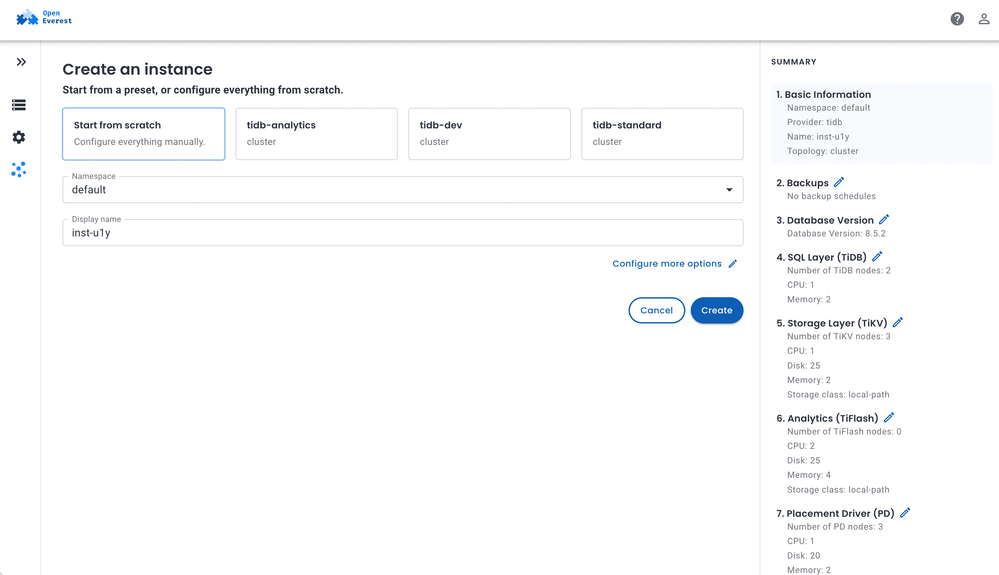
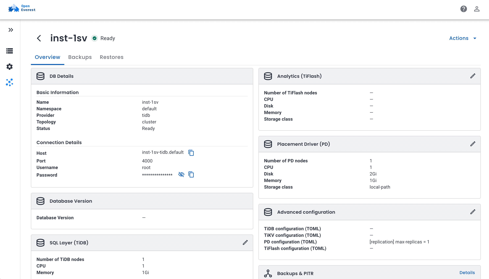
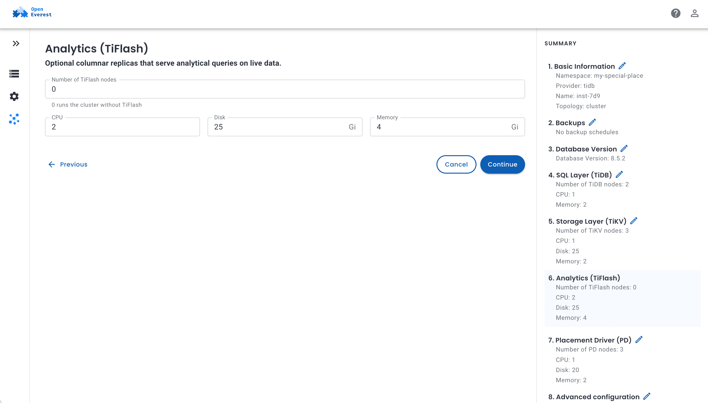
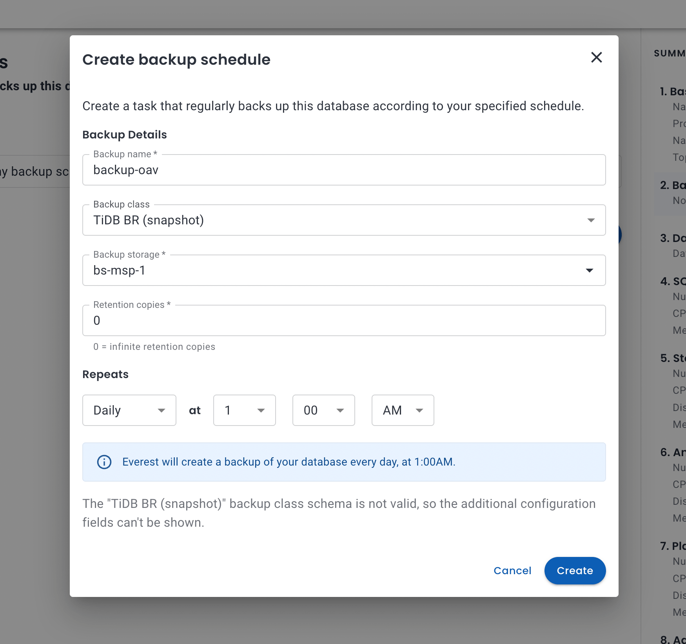

<style>
.tdb-widget{border:1px solid #e5e7eb;border-radius:12px;padding:20px 20px 14px;margin:2rem 0;background:#fff;color:#161641;font-family:-apple-system,BlinkMacSystemFont,'Segoe UI',Roboto,sans-serif;font-size:15px;line-height:1.4}
.tdb-widget *{box-sizing:border-box}
.tdb-widget code{font-size:13px;background:#f3f4f6;padding:1px 4px;border-radius:4px}
.tdb-title{font-size:19px;font-weight:700;margin:0 0 2px}
.tdb-sub{color:#6b7280;font-size:14px;margin:0 0 14px}
.tdb-controls{display:flex;flex-wrap:wrap;gap:10px 18px;align-items:center;margin-bottom:14px}
.tdb-group{display:inline-flex;flex-wrap:wrap;border:1px solid #d1d5db;border-radius:8px;overflow:hidden}
.tdb-group button{appearance:none;border:0;border-right:1px solid #d1d5db;background:#fff;color:#161641;font:inherit;font-size:14px;padding:6px 12px;cursor:pointer;line-height:1.3}
.tdb-group button:last-child{border-right:0}
.tdb-group button:hover{background:#f3f4f6}
.tdb-group button[aria-pressed="true"]{background:#161641;color:#fff}
.tdb-group button:focus-visible{outline:2px solid #0aa66e;outline-offset:-2px}
.tdb-label{font-size:13px;color:#6b7280;margin-right:6px}
.tdb-stats{display:grid;grid-template-columns:repeat(auto-fit,minmax(150px,1fr));gap:8px;margin-bottom:12px}
.tdb-stat{background:#f5f6fb;border-radius:8px;padding:8px 12px}
.tdb-stat b{display:block;font-size:20px;font-weight:700;color:#161641}
.tdb-stat span{font-size:12.5px;color:#6b7280}
.tdb-plot{position:relative;touch-action:pan-y}
.tdb-plot svg{display:block;width:100%;height:auto;user-select:none;font-family:-apple-system,BlinkMacSystemFont,'Segoe UI',Roboto,sans-serif}
.tdb-tip{position:absolute;top:8px;pointer-events:none;background:#161641;color:#fff;border-radius:8px;padding:8px 10px;font-size:13px;max-width:280px;box-shadow:0 4px 14px rgba(22,22,65,.25);z-index:2}
.tdb-tip-c{font-weight:600;margin:0 0 2px}
.tdb-tip-m{color:#e5e7eb;font-size:12px}
.tdb-tip-x{color:#fde68a;font-size:12px;margin-top:4px}
.tdb-legend{display:flex;flex-wrap:wrap;gap:6px 16px;margin-top:10px;font-size:13px;color:#374151}
.tdb-legend i{display:inline-block;width:11px;height:11px;border-radius:3px;margin-right:6px;vertical-align:-1px}
.tdb-note{font-size:12.5px;color:#6b7280;margin:10px 0 0}
.tdb-loading{color:#6b7280;padding:40px 0;text-align:center}
.tdb-table{margin:1.5rem 0;overflow-x:auto;border:1px solid rgba(127,127,127,0.25);border-radius:12px;}
.tdb-table table{width:100%;border-collapse:collapse;font-size:14px;line-height:1.5;margin:0;}
.tdb-table th,.tdb-table td{padding:9px 14px;text-align:left;vertical-align:top;border-bottom:1px solid rgba(127,127,127,0.18);}
.tdb-table tr:last-child td{border-bottom:0;}
.tdb-table th{background:rgba(127,127,127,0.06);font-weight:600;}
.tdb-table td:first-child{font-weight:600;color:#374151;}
.tdb-table.tdb-kv thead{display:none;}
.tdb-table.tdb-kv td:first-child{white-space:nowrap;width:1%;}
.tdb-table.tdb-wide td:first-child{width:22%;}
.tdb-table.tdb-num td:not(:first-child),.tdb-table.tdb-num th:not(:first-child){text-align:right;white-space:nowrap;}
.tdb-img{display:block;width:100%;height:auto;margin:1.5rem 0;border:1px solid rgba(127,127,127,0.25);border-radius:12px;padding:8px;background:#fff;}
</style>

When we were at KubeCon Japan and in Taipei this year, TiDB came up more often than PostgreSQL. Teams run it in production, on VMs and on Kubernetes, and more than one person told us they run it on plain StatefulSets with no operator at all. The alternative they compare against is TiDB Cloud.

There is a middle ground: an operator that does the work, on your own hardware. We recently shipped a [TiDB provider](https://github.com/openeverest/provider-tidb) for [OpenEverest](https://openeverest.io), built on [TiDB Operator v2](https://github.com/pingcap/tidb-operator). Instead of writing another "how to install" post, we rented an 8-node cluster and measured what someone planning to self-host TiDB actually wants to know:

- How long until I have a working cluster, and how small can it be?
- Can I really run analytics on the same database as my transactions?
- What happens to my application when I scale, lose a node, back up, or upgrade?
- What does TLS cost?

Along the way the tests found eight bugs and one missing feature in the provider. We fixed them and ran everything again; the numbers below are from the fixed build, and [the last section](#what-testing-changed-in-the-provider) lists what changed.

## TL;DR

Three Helm commands and one `Instance` gave us a highly available TiDB cluster serving SQL in about a minute. HTAP, the main reason to pick TiDB, held up: with analytics on TiFlash, transactions kept 93% of their throughput and analytical queries ran a median 8× faster than on TiKV. The catch is that you have to pin your transactional sessions to TiKV; left to the optimizer, TPC-C lost 65%.

Day-2 work under load was uneventful. New nodes joined in under a minute, losing a TiKV pod stalled some transactions for 10–15 seconds without failing any, and through TiProxy a rolling upgrade from 7.5 to 8.5 didn't drop a single connection. TLS everywhere costs about 7% of throughput.

Along the way the tests found eight bugs and a missing feature in the provider, [all fixed](#what-testing-changed-in-the-provider) in provider-tidb 0.2.2.

## TiDB in one minute

<div class="oe-flow not-prose" role="img" aria-label="Applications connect to stateless TiDB SQL nodes over the MySQL protocol. TiDB reads and writes rows in TiKV and runs analytical scans on TiFlash. TiKV replicates every Region with Raft; TiFlash receives the same Raft log as a learner and stores it in columns. PD hands out timestamps and decides where data lives. OpenEverest creates all of it from one Instance through provider-tidb and TiDB Operator v2.">
  <svg viewBox="0 0 920 330" xmlns="http://www.w3.org/2000/svg" width="100%" font-family="ui-sans-serif, system-ui, -apple-system, Segoe UI, Roboto, sans-serif">
    <defs>
      <marker id="tdb-arrow" viewBox="0 0 10 10" refX="9" refY="5" markerWidth="7" markerHeight="7" orient="auto-start-reverse"><path d="M0 0 L10 5 L0 10 z" fill="#6b7280"/></marker>
      <marker id="tdb-arrow-g" viewBox="0 0 10 10" refX="9" refY="5" markerWidth="7" markerHeight="7" orient="auto-start-reverse"><path d="M0 0 L10 5 L0 10 z" fill="#0aa66e"/></marker>
    </defs>
    <!-- OpenEverest lane -->
    <rect x="16" y="16" width="888" height="56" rx="10" fill="#e8f7f0" stroke="#0aa66e"/>
    <text x="34" y="40" font-size="14" font-weight="700" fill="#0f172a">OpenEverest</text>
    <text x="34" y="58" font-size="11.5" fill="#374151">one <tspan font-family="ui-monospace, Menlo, monospace">Instance</tspan> → provider-tidb → TiDB Operator v2 → the groups below, plus TLS, PodMonitor, S3 backups</text>
    <!-- app -->
    <rect x="16" y="140" width="120" height="70" rx="10" fill="#f3f4f6" stroke="#d1d5db"/>
    <text x="76" y="171" text-anchor="middle" font-size="14" font-weight="600" fill="#111827">Your app</text>
    <text x="76" y="190" text-anchor="middle" font-size="11" fill="#6b7280">MySQL protocol</text>
    <!-- TiDB -->
    <rect x="186" y="120" width="170" height="110" rx="10" fill="#fff7ed" stroke="#f59e0b"/>
    <text x="271" y="150" text-anchor="middle" font-size="15" font-weight="700" fill="#111827">TiDB</text>
    <text x="271" y="170" text-anchor="middle" font-size="11.5" fill="#4b5563">stateless SQL layer</text>
    <text x="271" y="188" text-anchor="middle" font-size="11.5" fill="#4b5563">parses, plans, picks</text>
    <text x="271" y="204" text-anchor="middle" font-size="11.5" fill="#4b5563">the storage engine</text>
    <!-- TiKV -->
    <rect x="430" y="96" width="210" height="84" rx="10" fill="#eff6ff" stroke="#2563eb"/>
    <text x="535" y="124" text-anchor="middle" font-size="15" font-weight="700" fill="#111827">TiKV</text>
    <text x="535" y="144" text-anchor="middle" font-size="11.5" fill="#4b5563">row store, transactions</text>
    <text x="535" y="161" text-anchor="middle" font-size="11.5" fill="#4b5563">3 Raft copies of every Region</text>
    <!-- TiFlash -->
    <rect x="430" y="214" width="210" height="84" rx="10" fill="#ecfdf5" stroke="#0aa66e"/>
    <text x="535" y="242" text-anchor="middle" font-size="15" font-weight="700" fill="#111827">TiFlash</text>
    <text x="535" y="262" text-anchor="middle" font-size="11.5" fill="#4b5563">column store, analytics (MPP)</text>
    <text x="535" y="279" text-anchor="middle" font-size="11.5" fill="#4b5563">Raft learner: same data, fresh</text>
    <!-- PD -->
    <rect x="714" y="140" width="190" height="96" rx="10" fill="#f5f3ff" stroke="#7c3aed"/>
    <text x="809" y="168" text-anchor="middle" font-size="15" font-weight="700" fill="#111827">PD</text>
    <text x="809" y="188" text-anchor="middle" font-size="11.5" fill="#4b5563">timestamps (TSO), metadata,</text>
    <text x="809" y="205" text-anchor="middle" font-size="11.5" fill="#4b5563">where every Region lives,</text>
    <text x="809" y="222" text-anchor="middle" font-size="11.5" fill="#4b5563">rebalancing</text>
    <!-- arrows -->
    <line x1="136" y1="175" x2="182" y2="175" stroke="#6b7280" stroke-width="2" marker-end="url(#tdb-arrow)"/>
    <line x1="356" y1="160" x2="426" y2="140" stroke="#6b7280" stroke-width="2" marker-end="url(#tdb-arrow)"/>
    <line x1="356" y1="196" x2="426" y2="250" stroke="#6b7280" stroke-width="2" marker-end="url(#tdb-arrow)"/>
    <line x1="535" y1="180" x2="535" y2="210" stroke="#0aa66e" stroke-width="2" stroke-dasharray="5 4" marker-end="url(#tdb-arrow-g)"/>
    <text x="545" y="200" font-size="10.5" fill="#0aa66e">Raft log</text>
    <line x1="640" y1="150" x2="710" y2="170" stroke="#7c3aed" stroke-width="1.5" stroke-dasharray="3 3"/>
    <line x1="640" y1="250" x2="710" y2="215" stroke="#7c3aed" stroke-width="1.5" stroke-dasharray="3 3"/>
    <path d="M300 120 C 300 98, 312 84, 336 84 L 770 84 C 794 84, 809 102, 809 136" fill="none" stroke="#7c3aed" stroke-width="1.5" stroke-dasharray="3 3"/>
  </svg>
</div>


TiDB is a distributed SQL database that speaks the MySQL protocol. It is four programs, and each one runs as its own group of pods:

<div class="tdb-table">

| Component | What it does | Stateful |
|---|---|---|
| TiDB | The SQL layer. Clients connect here; it parses, plans, and decides which storage engine to read from. | No |
| TiKV | The row store. Data is split into Regions, and every Region is kept in three copies with Raft. | Yes |
| TiFlash | Optional column store. It receives the same Raft log as TiKV as a learner, so analytical queries see fresh data without ETL. | Yes |
| PD | The Placement Driver: hands out transaction timestamps and decides which TiKV node holds which Region. | Yes |

</div>

With OpenEverest you don't create these yourself. You create one `Instance`, and the provider turns it into a TiDB Operator v2 `Cluster` with one group per component, plus TLS certificates, a `PodMonitor` and backup jobs.

## The test bed

<div class="tdb-table tdb-kv">

| | |
|---|---|
| Kubernetes | A managed Kubernetes service, Kubernetes 1.36, Frankfurt |
| Database nodes | 6 × dedicated 16 vCPU / 64 GB |
| Other nodes | 2 × dedicated 8 vCPU / 16 GB: one for OpenEverest, the operator and Prometheus, one for the load generator |
| Storage | The cloud provider's network block storage |
| Backups | The cloud provider's S3-compatible object storage, same region |
| Software | OpenEverest v2.0.0-dev.4, provider-tidb 0.2.2, TiDB Operator v2.0.1, TiDB 8.5.2 |
| Load | [go-tpc](https://github.com/pingcap/go-tpc): TPC-C and CH-benCHmark, 100 warehouses |

</div>

Database pods ran only on the database nodes (a taint and a node selector, set through the `Instance`'s scheduling policy), so the load generator and monitoring never competed with them for CPU.

### What the disks can do

TiKV commits every write to its Raft log with `fsync`, so disk latency shows up directly in write latency. Before installing anything we measured the network block storage against the node's local NVMe with `fio`:

<div class="tdb-table tdb-num">

| | Network block storage | Node-local NVMe |
|---|---|---|
| 4k random write, QD32 | 11.9k IOPS | 24.1k IOPS |
| 4k random read, QD32 | 15.5k IOPS | 71.4k IOPS |
| 1 MiB sequential write | 526 MiB/s | n/a (cache) |
| `fsync` latency, mean / p99 | 2.9 ms / 8.2 ms | 0.19 ms / 0.31 ms |

</div>

We used block storage for everything: it is what most managed Kubernetes users get by default, and it survives losing a node. Local NVMe would make writes faster, at the cost of both.

## From zero to a TiDB cluster

You need a Kubernetes cluster and Helm. Install OpenEverest, then the TiDB provider. The provider chart brings TiDB Operator v2 and its CRDs with it:

```bash
helm repo add openeverest https://openeverest.github.io/helm-charts/
helm install everest-core openeverest/openeverest --devel \
  --namespace everest-system --create-namespace

helm install provider-tidb oci://ghcr.io/openeverest/charts/provider-tidb \
  --namespace everest-system
```

The provider ships three presets, and the UI creates a cluster from any of them in one click:

<div class="tdb-table">

| Preset | PD | TiKV | TiDB | TiFlash | TiProxy | Requests (CPU / memory) | For |
|---|---|---|---|---|---|---|---|
| `tidb-dev` | 1 | 1 | 1 | – | – | 3 / 6 GiB | a laptop or CI |
| `tidb-standard` | 3 | 3 | 2 | – | 2 | 30 / 80 GiB | a highly available OLTP database |
| `tidb-analytics` | 3 | 3 | 2 | 2 | 2 | 38 / 144 GiB | transactions and analytics on the same data |

</div>



Without the UI, it is one resource. This is the `tidb-standard` preset written out:

```yaml
apiVersion: core.openeverest.io/v1alpha1
kind: Instance
metadata:
  name: orders
spec:
  providerRef:
    name: tidb
  version: "8.5.2"
  topology:
    type: cluster
    parameters:
      tls: {cluster: true, client: true}
      monitoring:
        prometheus: {enabled: true}
  components:
    pd:   {type: pd,   replicas: 3, resources: {limits: {cpu: "2", memory: 4Gi}},  storage: {size: 20Gi}}
    tikv: {type: tikv, replicas: 3, resources: {limits: {cpu: "4", memory: 16Gi}}, storage: {size: 100Gi}}
    tidb: {type: tidb, replicas: 2, resources: {limits: {cpu: "4", memory: 8Gi}}}
    tiproxy: {type: tiproxy, replicas: 2, resources: {limits: {cpu: "2", memory: 2Gi}}}
```

The connection details (the TiProxy endpoint on port 6000), the root password and the CA for TLS land in the `orders-conn` Secret. The UI shows them on the Instance's overview, here for a `tidb-dev` cluster, which has no TiProxy:



> *Tip:* use the full resource name, `kubectl get instances.core.openeverest.io`. TiDB Operator v2 puts its PD, TiKV and TiDB objects in a kubectl category called `instance`, so `kubectl get instance` lists those instead.

### How long it takes

<!-- ============================================================
     Interactive: pod-by-pod startup of a TiDB cluster
     Data: ttr.json in this page bundle
     ============================================================ -->
<div class="tdb-widget not-prose" id="tdb-ttr" data-src="/blog/self-hosting-tidb-on-kubernetes/ttr.json">
<p class="tdb-title">How a TiDB cluster starts, pod by pod</p>
<p class="tdb-sub">Each bar is one pod, from the moment the <code>Instance</code> was applied. Compare provider-tidb 0.2.0 with the fixed build, and hover over a bar for its timings.</p>
<div class="tdb-controls"><div><span class="tdb-label">Run</span><div class="tdb-group" data-k="run" role="group" aria-label="Run"></div></div></div>
<div class="tdb-stats" aria-live="polite"></div>
<div class="tdb-plot"><div class="tdb-loading">Loading…</div><div class="tdb-tip" hidden></div></div>
<div class="tdb-legend">
<span><i style="background:#d1d5db"></i>Waiting to be scheduled</span>
<span><i style="background:#a78bfa"></i>Attaching the volume</span>
<span><i style="background:#fbbf24"></i>Pulling the image</span>
<span><i style="background:#60a5fa"></i>Starting up</span>
<span><i style="background:#f87171"></i>Starting up, with restarts</span>
</div>
<p class="tdb-note">Timestamps come from pod conditions and Kubernetes events, so they're accurate to about one second. TiDB pods have no volume.</p>
</div>
<script>
(function () {
  var root = document.getElementById("tdb-ttr");
  if (!root) return;
  var COMP = { pd: "PD", tikv: "TiKV", tidb: "TiDB", tiflash: "TiFlash", tiproxy: "TiProxy" };
  var ORDER = ["pd", "tikv", "tiflash", "tidb", "tiproxy"];
  var state = { run: null }, data;
  var plot = root.querySelector(".tdb-plot"), tip = root.querySelector(".tdb-tip");
  function esc(s) { return String(s).replace(/[&<>"]/g, function (c) { return { "&": "&amp;", "<": "&lt;", ">": "&gt;", '"': "&quot;" }[c]; }); }
  function s(v) { return v == null ? "–" : v.toFixed(0) + "s"; }
  function buttons() {
    var g = root.querySelector('.tdb-group[data-k="run"]');
    g.innerHTML = data.runs.map(function (r) {
      return '<button type="button" data-v="' + r.id + '" aria-pressed="' + (state.run === r.id) + '">' + esc(r.label) + "</button>";
    }).join("");
    g.onclick = function (e) { var b = e.target.closest("button"); if (!b) return; state.run = b.dataset.v; draw(); };
  }
  function draw() {
    buttons();
    var run = data.runs.filter(function (r) { return r.id === state.run; })[0];
    var pods = run.pods.slice().sort(function (a, b) { return ORDER.indexOf(a.c) - ORDER.indexOf(b.c) || a.n.localeCompare(b.n); });
    var restarts = pods.reduce(function (n, p) { return n + p.x; }, 0);
    var pdR = pods.filter(function (p) { return p.c === "pd"; }).map(function (p) { return p.r; });
    root.querySelector(".tdb-stats").innerHTML =
      '<div class="tdb-stat"><b>' + run.sql.toFixed(0) + 's</b><span>until PD, TiKV and TiDB are all up</span></div>' +
      '<div class="tdb-stat"><b>' + run.ready.toFixed(0) + 's</b><span>until the Instance is Ready' + (pods.some(function (p) { return p.c === "tiproxy"; }) ? " (incl. TiProxy)" : "") + '</span></div>' +
      '<div class="tdb-stat"><b>' + restarts + '</b><span>container restarts during bootstrap</span></div>' +
      '<div class="tdb-stat"><b>' + (Math.max.apply(null, pdR) - Math.min.apply(null, pdR)).toFixed(0) + 's</b><span>between the first and the last PD being ready</span></div>';
    var W = 760, L = 78, R = 40, T = 26, ROW = 24, H = T + pods.length * ROW + 26;
    var max = Math.ceil(Math.max(run.ready, 60) / 20) * 20, x = function (t) { return L + (W - L - R) * t / max; };
    var o = ['<svg viewBox="0 0 ' + W + " " + H + '" role="img" aria-label="Pod startup timeline for ' + esc(run.label) + '">'];
    for (var g = 0; g <= max; g += 20) {
      o.push('<line x1="' + x(g) + '" x2="' + x(g) + '" y1="' + (T - 6) + '" y2="' + (H - 22) + '" stroke="#eef0f4"/>');
      o.push('<text x="' + x(g) + '" y="' + (H - 6) + '" font-size="11" fill="#6b7280" text-anchor="middle">' + g + "s</text>");
    }
    pods.forEach(function (p, i) {
      var y = T + i * ROW, h = 14;
      o.push('<text x="' + (L - 8) + '" y="' + (y + 11) + '" font-size="12" fill="#161641" text-anchor="end">' + COMP[p.c] + " " + p.n.split("-")[1] + "</text>");
      var segs = [[0, p.s, "#d1d5db"]], t = p.s;
      if (p.a != null) { segs.push([t, p.a, "#a78bfa"]); t = p.a; }
      if (p.p != null && p.p > t) { segs.push([t, p.p, "#fbbf24"]); t = p.p; }
      segs.push([t, p.r, p.x > 0 ? "#f87171" : "#60a5fa"]);
      segs.forEach(function (sg) {
        if (sg[1] > sg[0]) o.push('<rect x="' + x(sg[0]) + '" y="' + y + '" width="' + Math.max(1, x(sg[1]) - x(sg[0])) + '" height="' + h + '" rx="2" fill="' + sg[2] + '"/>');
      });
      if (p.x > 0) o.push('<text x="' + (x(p.r) + 5) + '" y="' + (y + 11) + '" font-size="11" fill="#b91c1c">↻ ' + p.x + "</text>");
      o.push('<rect class="tdb-hit" data-i="' + i + '" x="0" y="' + (y - 4) + '" width="' + W + '" height="' + ROW + '" fill="transparent"/>');
    });
    o.push('<line x1="' + x(run.ready) + '" x2="' + x(run.ready) + '" y1="' + (T - 10) + '" y2="' + (H - 22) + '" stroke="#0aa66e" stroke-width="2" stroke-dasharray="4 3"/>');
    o.push('<text x="' + (x(run.ready) - 4) + '" y="' + (T - 12) + '" font-size="11" fill="#0aa66e" text-anchor="end">Instance Ready</text>');
    o.push("</svg>");
    var old = plot.querySelector("svg"), ld = plot.querySelector(".tdb-loading");
    if (ld) ld.remove();
    var wrap = document.createElement("div"); wrap.innerHTML = o.join("");
    var svg = wrap.firstChild;
    if (old) plot.replaceChild(svg, old); else plot.insertBefore(svg, tip);
    svg.addEventListener("mousemove", function (e) {
      var hit = e.target.closest(".tdb-hit");
      if (!hit) { tip.hidden = true; return; }
      var p = pods[+hit.dataset.i];
      tip.innerHTML = '<div class="tdb-tip-c">' + COMP[p.c] + " " + p.n.split("-")[1] + "</div>" +
        '<div class="tdb-tip-m">Scheduled ' + s(p.s) + (p.a != null ? " · volume attached " + s(p.a) : "") +
        " · image ready " + s(p.p) + "</div>" + '<div class="tdb-tip-m">Ready at ' + s(p.r) + "</div>" +
        (p.x ? '<div class="tdb-tip-x">Restarted ' + p.x + " times before it came up</div>" : "");
      tip.hidden = false;
      var r = plot.getBoundingClientRect();
      tip.style.left = Math.min(e.clientX - r.left + 14, r.width - 270) + "px";
      tip.style.top = (e.clientY - r.top + 12) + "px";
    });
    svg.addEventListener("mouseleave", function () { tip.hidden = true; });
  }
  fetch(root.dataset.src).then(function (r) { return r.json(); }).then(function (d) { data = d; state.run = d.runs[0].id; draw(); })
    .catch(function () { plot.querySelector(".tdb-loading").textContent = "Could not load the data."; });
})();
</script>


On the test cluster, with images already on the nodes, a `tidb-standard` cluster had PD, TiKV and TiDB up and serving SQL *50–78 seconds* after the `Instance` was applied, and `tidb-analytics` (adding two TiFlash nodes) in *55–57 seconds*. The `Instance` turns `Ready` once TiProxy is up too, which took up to another 67 seconds; more on why in [What testing changed](#what-testing-changed-in-the-provider). Most of the rest is Kubernetes work: attaching the block-storage volumes takes 10–30 seconds per pod, and in every run one or two PDs waited another 35–45 seconds for their DNS name to resolve consistently. Most of the remaining time is Kubernetes work: attaching the block-storage volumes takes 10–20 seconds per pod.

The first version of this chart looked different. On provider-tidb 0.2.0, two of the three PD pods crash-looped two or three times during every bootstrap, and the whole cluster waited for the last one: switch between the runs to see it. The cause, and the fix, are in the last section; with it, there were no restarts in any run.


## HTAP: analytics on the transactional database

This is the reason most people look at TiDB. Analytical queries usually go to a separate warehouse that an ETL job feeds every hour or every night. TiFlash keeps a columnar copy of the same tables inside the cluster, updated through Raft, so a report can read data that was committed a few milliseconds ago, without slowing down the transactions that wrote it. At least, that's the promise. We tested it with [CH-benCHmark](https://db.in.tum.de/research/projects/CHbenCHmark/): TPC-C transactions and 22 TPC-H-style analytical queries running at the same time on the same 100-warehouse dataset (4.5 GB of data, 30 million `order_line` rows, before TiKV keeps three copies).

### Step 1: add TiFlash replicas

TiFlash nodes start with the `tidb-analytics` preset, or with any Instance once you give the analytics layer some nodes:



Tables only get a columnar copy when you ask:

```sql
ALTER TABLE order_line SET TIFLASH REPLICA 2;
SELECT table_name, progress, available FROM information_schema.tiflash_replica;
```

For all 12 tables, two replicas each, that took *208 seconds*.

### Step 2: run transactions and analytics together

We ran 32 TPC-C clients for 15 minutes, with 2 more clients running the 22 analytical queries in a loop, a couple of busy dashboards, in four configurations:

<!-- ============================================================
     Interactive: HTAP — transactions and analytics on one cluster
     Data: htap.json in this page bundle
     ============================================================ -->
<div class="tdb-widget not-prose" id="tdb-htap" data-src="/blog/self-hosting-tidb-on-kubernetes/htap.json">
<p class="tdb-title">Transactions and analytics on the same cluster</p>
<p class="tdb-sub">CH-benCHmark on 100 warehouses: 32 clients run TPC-C transactions while 2 clients run the 22 analytical queries in a loop, like a couple of busy dashboards.</p>
<div class="tdb-controls">
<div><span class="tdb-label">View</span><div class="tdb-group" data-k="view" role="group" aria-label="View"></div></div>
</div>
<div class="tdb-stats" aria-live="polite"></div>
<div class="tdb-plot"><div class="tdb-loading">Loading…</div><div class="tdb-tip" hidden></div></div>
<div class="tdb-legend"></div>
<p class="tdb-note"></p>
</div>
<script>
(function () {
  var root = document.getElementById("tdb-htap");
  if (!root) return;
  var VIEWS = [["tx", "Transactions per minute"], ["q", "Analytical queries"]];
  var state = { view: "tx" }, data;
  var plot = root.querySelector(".tdb-plot"), tip = root.querySelector(".tdb-tip");
  var fmt = function (n) { return n >= 1000 ? (n / 1000).toFixed(1) + "k" : Math.round(n) + ""; };
  function esc(s) { return String(s).replace(/[&<>"]/g, function (c) { return { "&": "&amp;", "<": "&lt;", ">": "&gt;", '"': "&quot;" }[c]; }); }
  function buttons() {
    var g = root.querySelector('.tdb-group[data-k="view"]');
    g.innerHTML = VIEWS.map(function (v) { return '<button type="button" data-v="' + v[0] + '" aria-pressed="' + (state.view === v[0]) + '">' + v[1] + "</button>"; }).join("");
    g.onclick = function (e) { var b = e.target.closest("button"); if (!b) return; state.view = b.dataset.v; draw(); };
  }
  function mount(svgText, onMove) {
    var old = plot.querySelector("svg"), ld = plot.querySelector(".tdb-loading");
    if (ld) ld.remove();
    var wrap = document.createElement("div"); wrap.innerHTML = svgText;
    var svg = wrap.firstChild;
    if (old) plot.replaceChild(svg, old); else plot.insertBefore(svg, tip);
    svg.addEventListener("mousemove", function (e) {
      var html = onMove(e, svg);
      if (!html) { tip.hidden = true; return; }
      tip.innerHTML = html; tip.hidden = false;
      var r = plot.getBoundingClientRect();
      tip.style.left = Math.min(e.clientX - r.left + 14, r.width - 270) + "px";
      tip.style.top = (e.clientY - r.top + 12) + "px";
    });
    svg.addEventListener("mouseleave", function () { tip.hidden = true; });
  }
  function drawTx() {
    var sc = data.scenarios;
    root.querySelector(".tdb-stats").innerHTML = sc.map(function (s) {
      return '<div class="tdb-stat" style="border-left:4px solid ' + s.color + '"><b>' + fmt(s.tpmC) + ' tpmC</b><span>' + esc(s.label) + " · NewOrder p99 " + Math.round(s.p99) + " ms</span></div>";
    }).join("");
    var W = 760, H = 300, L = 52, R = 14, T = 14, B = 34;
    var n = Math.max.apply(null, sc.map(function (s) { return s.tl.length; }));
    var maxY = Math.ceil(Math.max.apply(null, sc.map(function (s) { return Math.max.apply(null, s.tl); })) / 5000) * 5000;
    var x = function (i) { return L + (W - L - R) * i / (n - 1); }, y = function (v) { return T + (H - T - B) * (1 - v / maxY); };
    var o = ['<svg viewBox="0 0 ' + W + " " + H + '" role="img" aria-label="NewOrder transactions per minute over time, per scenario">'];
    for (var v = 0; v <= maxY; v += 5000) {
      o.push('<line x1="' + L + '" x2="' + (W - R) + '" y1="' + y(v) + '" y2="' + y(v) + '" stroke="#eef0f4"/>');
      o.push('<text x="' + (L - 6) + '" y="' + (y(v) + 4) + '" font-size="11" fill="#6b7280" text-anchor="end">' + fmt(v) + "</text>");
    }
    for (var m = 0; m <= (n - 1) * 10 / 60; m += 2) {
      var xi = x(m * 6);
      o.push('<text x="' + xi + '" y="' + (H - 12) + '" font-size="11" fill="#6b7280" text-anchor="middle">' + m + " min</text>");
    }
    sc.forEach(function (s) {
      o.push('<polyline fill="none" stroke="' + s.color + '" stroke-width="2.2" stroke-linejoin="round" points="' +
        s.tl.map(function (v, i) { return x(i).toFixed(1) + "," + y(v).toFixed(1); }).join(" ") + '"/>');
    });
    o.push('<line class="tdb-cursor" x1="0" x2="0" y1="' + T + '" y2="' + (H - B) + '" stroke="#161641" stroke-opacity=".25" visibility="hidden"/>');
    o.push("</svg>");
    mount(o.join(""), function (e, svg) {
      var r = svg.getBoundingClientRect(), px = (e.clientX - r.left) * W / r.width;
      var i = Math.round((px - L) / (W - L - R) * (n - 1));
      var cur = svg.querySelector(".tdb-cursor");
      if (i < 0 || i >= n) { cur.setAttribute("visibility", "hidden"); return null; }
      cur.setAttribute("x1", x(i)); cur.setAttribute("x2", x(i)); cur.setAttribute("visibility", "visible");
      return '<div class="tdb-tip-c">' + (i * 10 / 60).toFixed(1) + " min into the run</div>" + sc.map(function (s) {
        return '<div class="tdb-tip-m"><span style="color:' + s.color + '">●</span> ' + esc(s.short) + ": " + (s.tl[i] != null ? fmt(s.tl[i]) + " NewOrder/min" : "–") + "</div>";
      }).join("");
    });
    root.querySelector(".tdb-legend").innerHTML = sc.map(function (s) { return '<span><i style="background:' + s.color + '"></i>' + esc(s.label) + "</span>"; }).join("");
    root.querySelector(".tdb-note").textContent = "NewOrder transactions per minute, sampled every 10 seconds by the client (go-tpc). tpmC is the NewOrder rate over the whole run.";
  }
  function drawQ() {
    var P = data.power, E = data.engines;
    var tot = E.map(function (en) {
      var ok = P.filter(function (q) { return !q[en.id].err; });
      return { en: en, ok: ok.length, sum: ok.reduce(function (a, q) { return a + q[en.id].s; }, 0) };
    });
    root.querySelector(".tdb-stats").innerHTML = tot.map(function (t) {
      return '<div class="tdb-stat" style="border-left:4px solid ' + t.en.color + '"><b>' + t.ok + " / 22 completed</b><span>" + esc(t.en.label) + "</span></div>";
    }).join("");
    var W = 760, L = 48, R = 10, T = 12, B = 30, ROWH = 0, H = 330;
    var lo = 0.05, hi = 100, ly = function (v) { return T + (H - T - B) * (1 - (Math.log10(v) - Math.log10(lo)) / (Math.log10(hi) - Math.log10(lo))); };
    var gw = (W - L - R) / P.length, bw = Math.min(9, (gw - 6) / E.length);
    var o = ['<svg viewBox="0 0 ' + W + " " + H + '" role="img" aria-label="Execution time of each analytical query, per engine, log scale">'];
    [0.1, 1, 10, 100].forEach(function (v) {
      o.push('<line x1="' + L + '" x2="' + (W - R) + '" y1="' + ly(v) + '" y2="' + ly(v) + '" stroke="#eef0f4"/>');
      o.push('<text x="' + (L - 6) + '" y="' + (ly(v) + 4) + '" font-size="11" fill="#6b7280" text-anchor="end">' + v + "s</text>");
    });
    P.forEach(function (q, i) {
      var gx = L + i * gw + (gw - bw * E.length) / 2;
      E.forEach(function (en, j) {
        var r = q[en.id], bx = gx + j * bw;
        if (r.err) {
          o.push('<text x="' + (bx + bw / 2) + '" y="' + (ly(lo) - 4) + '" font-size="11" font-weight="700" fill="#dc2626" text-anchor="middle">✕</text>');
        } else {
          o.push('<rect x="' + bx + '" y="' + ly(Math.max(r.s, lo)) + '" width="' + (bw - 1) + '" height="' + (ly(lo) - ly(Math.max(r.s, lo))) + '" fill="' + en.color + '"/>');
        }
      });
      o.push('<text x="' + (L + i * gw + gw / 2) + '" y="' + (H - 12) + '" font-size="10.5" fill="#374151" text-anchor="middle">' + q.q.replace("q", "Q") + "</text>");
      o.push('<rect class="tdb-hit" data-i="' + i + '" x="' + (L + i * gw) + '" y="' + T + '" width="' + gw + '" height="' + (H - T - B) + '" fill="transparent"/>');
    });
    o.push("</svg>");
    mount(o.join(""), function (e) {
      var hit = e.target.closest(".tdb-hit"); if (!hit) return null;
      var q = P[+hit.dataset.i];
      return '<div class="tdb-tip-c">' + q.q.toUpperCase() + "</div>" + E.map(function (en) {
        var r = q[en.id];
        return '<div class="tdb-tip-m"><span style="color:' + en.color + '">●</span> ' + esc(en.short) + ": " + (r.err ? '<span style="color:#fca5a5">failed: ' + esc(r.err) + "</span>" : r.s.toFixed(2) + "s") + "</div>";
      }).join("");
    });
    root.querySelector(".tdb-legend").innerHTML = E.map(function (en) { return '<span><i style="background:' + en.color + '"></i>' + esc(en.label) + "</span>"; }).join("") +
      '<span><b style="color:#dc2626;margin-right:6px">✕</b>Query failed</span>';
    root.querySelector(".tdb-note").textContent = "Each query run once, one at a time, with no other load (first run of two; later runs on TiKV can be answered from TiDB's coprocessor cache). Log scale.";
  }
  function draw() { buttons(); if (state.view === "tx") drawTx(); else drawQ(); }
  fetch(root.dataset.src).then(function (r) { return r.json(); }).then(function (d) { data = d; draw(); })
    .catch(function () { plot.querySelector(".tdb-loading").textContent = "Could not load the data."; });
})();
</script>


- **TPC-C alone** did 24.2k tpmC (New-Order transactions per minute) with a p99 of 76 ms. This is the baseline.
- **Analytics on TiKV** cut it to 10.3k tpmC (−57%), with p99 at 285 ms. The row store has to scan and join millions of rows for every report, and the transactions queue behind it. Even so, 13 analytical queries failed, most of them stopped by TiDB's 1 GiB per-query memory limit while joining the rows TiKV sent it.
- **Analytics on TiFlash** kept 22.6k tpmC (−6.5%) and an 84 ms p99, while the dashboards ran *3.1× more queries* (470 queries per hour, QphH, against 152).
- **Letting the optimizer pick** for every session was the worst of both: 8.6k tpmC (−65%) with a 176 ms p99, even though the dashboards got 296 QphH.

The "Analytical queries" view runs each of the 22 queries once on an idle cluster. On TiKV, 19 finished and three hit the 1 GiB limit. On TiFlash, all 22 finished, a median of *8× faster*: Q1 went from 2.7 s to 0.5 s, Q13 from 2.8 s to 0.14 s, and Q4 from 24.3 s to 0.8 s (32×).

*Pin your OLTP sessions.* The orange line is the trap. Once tables have TiFlash replicas, TiDB's optimizer may pick TiFlash for *any* query that looks cheaper there, including the Stock-Level and Order-Status parts of TPC-C. With TiFlash busy serving reports, those transactions waited behind them. Compared with the pinned run, the average Stock-Level went from 19 ms to 578 ms, Order-Status from 13 ms to 235 ms, and Delivery from 102 ms to 760 ms. TiDB's answer is engine isolation. Set it per session in your OLTP connection pool:

```sql
SET SESSION tidb_isolation_read_engines = 'tikv,tidb';
```

or make TiKV the default for every session through the TiDB `config` parameter of the `Instance`, and let reporting tools opt in with `'tiflash,tidb'`:

```toml
[isolation-read]
engines = ["tikv", "tidb"]
```

In our test with four analytical clients, that one setting took unpinned TPC-C from 6.6k back to 24.0k tpmC, and the analytical sessions still read from TiFlash.

### Step 3: how fresh is "real time"?

TiFlash is a Raft learner: before it answers, it checks it has caught up with the leader. We wrote a row to TiKV and immediately read it back through TiFlash, 1,000 times:

<div class="tdb-table tdb-num">

| | Rows visible right away | Read latency p50 | p99 |
|---|---|---|---|
| Idle cluster | 1,000 of 1,000 | 5.9 ms | 9.3 ms |
| During the HTAP run above | 1,000 of 1,000 | 104 ms | 1.6 s |

</div>

Every read saw the row that had just been committed. Under load, TiFlash first finished the analytical work it was busy with, so the read waited; it never returned stale data.

### What about memory?

TiFlash runs joins and aggregations in memory, and that is what to size it for. We started with 16 GiB per TiFlash node; under CH-benCHmark TiFlash hit its memory limit, failed analytical queries and, before we pinned sessions, the OLTP statements the optimizer had sent to it. The `tidb-analytics` preset now gives TiFlash 32 GiB.

With *four* analytical clients instead of two, even 32 GiB was tight: transactions on TiKV were unaffected (23.2k tpmC), but 3.5–24% of the analytical queries failed in different runs. Once the heaviest join (Q9) takes TiFlash over its limit (80% of the container's memory), TiFlash turns away new queries until it is back under it. Two ways out:

- **More memory per TiFlash node**, or more TiFlash nodes, for more concurrent heavy queries.
- **Query-level spilling.** `SET GLOBAL tiflash_mem_quota_query_per_node = 6442450944;` makes TiFlash spill a query's joins and aggregations to disk past 70% of 6 GiB. In our test it cut the failures to four, at the price of half the analytical throughput, because the spill files went to network block storage.

## Scaling, losing a node, backups and upgrades, under load

Benchmarks on a quiet cluster are easy. The questions that matter are about the moments you change something while the application is running. For each test below, 32–64 TPC-C clients were running the whole time, and for the disruptive ones a probe inserted a row every 100 ms on its own connection, so every stall is measured from the client side. Pick a test:

<!-- ============================================================
     Interactive: timelines under load (scaling, day-2 operations, upgrade)
     Data: timeline.json in this page bundle
     ============================================================ -->
<div class="tdb-widget not-prose" id="tdb-tl" data-src="/blog/self-hosting-tidb-on-kubernetes/timeline.json" data-ds="scale">
<p class="tdb-title"></p>
<p class="tdb-sub"></p>
<div class="tdb-controls"><div><span class="tdb-label">Test</span><div class="tdb-group" data-k="ds" role="group" aria-label="Test"></div></div></div>
<div class="tdb-stats" aria-live="polite"></div>
<div class="tdb-plot"><div class="tdb-loading">Loading…</div><div class="tdb-tip" hidden></div></div>
<div class="tdb-legend"></div>
<p class="tdb-note"></p>
</div>
<script>
(function () {
  var root = document.getElementById("tdb-tl");
  if (!root) return;
  var state = { ds: root.dataset.ds }, data;
  var plot = root.querySelector(".tdb-plot"), tip = root.querySelector(".tdb-tip");
  function esc(s) { return String(s).replace(/[&<>"]/g, function (c) { return { "&": "&amp;", "<": "&lt;", ">": "&gt;", '"': "&quot;" }[c]; }); }
  function fmtV(v, unit) {
    if (v == null) return "–";
    if (unit === "/min") return (v >= 1000 ? (v / 1000).toFixed(1) + "k" : Math.round(v)) + unit;
    if (unit === "ms") return (v >= 1000 ? (v / 1000).toFixed(2) + " s" : v.toFixed(v < 10 ? 1 : 0) + " ms");
    return (v >= 1000 ? (v / 1000).toFixed(1) + "k" : (v < 10 && v % 1 ? v.toFixed(1) : Math.round(v))) + (unit ? " " + unit : "");
  }
  function mmss(s) { s = Math.round(s); return Math.floor(s / 60) + ":" + ("0" + (s % 60)).slice(-2); }
  function nearest(pts, t) {
    var lo = 0, hi = pts.length - 1;
    if (!pts.length) return null;
    while (lo < hi) { var mid = (lo + hi) >> 1; if (pts[mid][0] < t) lo = mid + 1; else hi = mid; }
    var c = pts[lo], p = pts[lo - 1];
    if (p && Math.abs(p[0] - t) < Math.abs(c[0] - t)) c = p;
    return Math.abs(c[0] - t) <= 6 ? c : null;
  }
  function buttons() {
    var g = root.querySelector('.tdb-group[data-k="ds"]');
    g.innerHTML = data.order.map(function (k) { return '<button type="button" data-v="' + k + '" aria-pressed="' + (state.ds === k) + '">' + esc(data.sets[k].tab) + "</button>"; }).join("");
    g.onclick = function (e) { var b = e.target.closest("button"); if (!b) return; state.ds = b.dataset.v; draw(); };
  }
  function draw() {
    buttons();
    var ds = data.sets[state.ds];
    root.querySelector(".tdb-title").textContent = ds.title;
    root.querySelector(".tdb-sub").textContent = ds.sub;
    root.querySelector(".tdb-note").textContent = ds.note || "";
    root.querySelector(".tdb-stats").innerHTML = (ds.stats || []).map(function (s) { return '<div class="tdb-stat"><b>' + esc(s[0]) + "</b><span>" + esc(s[1]) + "</span></div>"; }).join("");
    var W = 760, L = 58, R = 14, TOP = 66, PH = 120, GAP = 26, B = 28;
    var panels = ds.panels, H = TOP + panels.length * (PH + GAP) - GAP + B;
    var x = function (t) { return L + (W - L - R) * t / ds.dur; };
    var o = ['<svg viewBox="0 0 ' + W + " " + H + '" role="img" aria-label="' + esc(ds.title) + '">'];
    var step = ds.dur > 2400 ? 600 : ds.dur > 900 ? 300 : 120;
    for (var t = 0; t <= ds.dur; t += step) o.push('<text x="' + x(t) + '" y="' + (H - 8) + '" font-size="11" fill="#6b7280" text-anchor="middle">' + Math.round(t / 60) + " min</text>");
    var yfs = [];
    panels.forEach(function (p, pi) {
      var top = TOP + pi * (PH + GAP), all = [];
      p.series.forEach(function (s) { s.pts.forEach(function (q) { all.push(q[1]); }); });
      var dataMax = Math.max.apply(null, all.concat([1]));
      var maxV = p.max || dataMax * 1.1, minV = p.log ? (p.min || 1) : 0;
      if (p.log && dataMax > maxV) maxV = Math.pow(10, Math.ceil(Math.log10(dataMax)));
      var y = p.log
        ? function (v) { v = Math.max(v, minV); return top + PH * (1 - (Math.log10(v) - Math.log10(minV)) / (Math.log10(maxV) - Math.log10(minV))); }
        : function (v) { return top + PH * (1 - v / maxV); };
      yfs.push(y);
      o.push('<rect x="' + L + '" y="' + top + '" width="' + (W - L - R) + '" height="' + PH + '" fill="#fafbfd" stroke="#eef0f4"/>');
      o.push('<text x="' + L + '" y="' + (top - 6) + '" font-size="12" font-weight="600" fill="#161641">' + esc(p.title) + "</text>");
      var ticks = p.log ? [1, 10, 100, 1000, 10000].filter(function (v) { return v >= minV && v <= maxV; }) : [0, maxV / 2, maxV];
      ticks.forEach(function (v) { o.push('<text x="' + (L - 6) + '" y="' + (y(v) + 4) + '" font-size="10.5" fill="#6b7280" text-anchor="end">' + fmtV(v, p.unit).replace(" ms", "ms").replace("/min", "") + "</text>"); });
      p.series.forEach(function (s) {
        if (s.dots) {
          s.pts.forEach(function (q) { o.push('<circle cx="' + x(q[0]).toFixed(1) + '" cy="' + y(q[1]).toFixed(1) + '" r="1.6" fill="' + s.color + '" fill-opacity=".55"/>'); });
        } else {
          var seg = [], prev = null;
          s.pts.forEach(function (q) {
            if (prev && q[0] - prev[0] > (s.gap || 30)) { seg.push("M"); }
            seg.push(x(q[0]).toFixed(1) + "," + y(q[1]).toFixed(1)); prev = q;
          });
          o.push('<path fill="none" stroke="' + s.color + '" stroke-width="' + (s.w || 1.8) + '" stroke-linejoin="round" d="M' + seg.join(" L").replace(/ LM /g, " M") + '"/>');
        }
      });
      (p.marks || []).forEach(function (m) { o.push('<text x="' + x(m[0]) + '" y="' + (top + PH - 3) + '" font-size="12" font-weight="700" fill="#dc2626" text-anchor="middle">✕</text>'); });
    });
    var lastX = -100, lane = 0;
    ds.events.forEach(function (ev, i) {
      var ex = x(ev[0]);
      lane = ex - lastX < 20 ? (lane + 1) % 3 : 0; lastX = ex;
      var cy = 12 + lane * 18;
      o.push('<line x1="' + ex + '" x2="' + ex + '" y1="' + (cy + 8) + '" y2="' + (H - B) + '" stroke="' + (ev[2] || "#0aa66e") + '" stroke-width="1.4" stroke-dasharray="4 3"/>');
      o.push('<circle cx="' + ex + '" cy="' + cy + '" r="8" fill="' + (ev[2] || "#0aa66e") + '"/><text x="' + ex + '" y="' + (cy + 4) + '" font-size="10.5" font-weight="700" fill="#fff" text-anchor="middle">' + (i + 1) + "</text>");
    });
    o.push('<line class="tdb-cursor" x1="0" x2="0" y1="' + TOP + '" y2="' + (H - B) + '" stroke="#161641" stroke-opacity=".3" visibility="hidden"/>');
    o.push("</svg>");
    var old = plot.querySelector("svg"), ld = plot.querySelector(".tdb-loading");
    if (ld) ld.remove();
    var wrap = document.createElement("div"); wrap.innerHTML = o.join("");
    var svg = wrap.firstChild;
    if (old) plot.replaceChild(svg, old); else plot.insertBefore(svg, tip);
    svg.addEventListener("mousemove", function (e) {
      var r = svg.getBoundingClientRect(), px = (e.clientX - r.left) * W / r.width, t = (px - L) / (W - L - R) * ds.dur;
      var cur = svg.querySelector(".tdb-cursor");
      if (t < 0 || t > ds.dur) { cur.setAttribute("visibility", "hidden"); tip.hidden = true; return; }
      cur.setAttribute("x1", px); cur.setAttribute("x2", px); cur.setAttribute("visibility", "visible");
      var html = '<div class="tdb-tip-c">' + mmss(t) + " into the test</div>";
      ds.events.forEach(function (ev, i) { if (Math.abs(ev[0] - t) < ds.dur / 80) html += '<div class="tdb-tip-x">' + (i + 1) + ". " + esc(ev[1]) + "</div>"; });
      panels.forEach(function (p) {
        p.series.forEach(function (s) {
          if (s.hide) return;
          var q = nearest(s.pts, t);
          if (q) html += '<div class="tdb-tip-m"><span style="color:' + s.color + '">●</span> ' + esc(s.name) + ": " + fmtV(q[1], p.unit) + "</div>";
        });
      });
      tip.innerHTML = html; tip.hidden = false;
      tip.style.left = Math.min(e.clientX - plot.getBoundingClientRect().left + 14, r.width - 270) + "px";
      tip.style.top = (e.clientY - plot.getBoundingClientRect().top + 12) + "px";
    });
    svg.addEventListener("mouseleave", function () { tip.hidden = true; svg.querySelector(".tdb-cursor").setAttribute("visibility", "hidden"); });
    var leg = [];
    panels.forEach(function (p) { p.series.forEach(function (s) { if (!s.hide && !s.nolegend) leg.push('<span><i style="background:' + s.color + '"></i>' + esc(s.name) + "</span>"); }); });
    root.querySelector(".tdb-legend").innerHTML = leg.join("") + '<span style="flex-basis:100%"></span>' +
      ds.events.map(function (ev, i) { return '<span><b style="color:' + (ev[2] || "#0aa66e") + ';margin-right:4px">' + (i + 1) + ".</b>" + esc(ev[1]) + " (" + mmss(ev[0]) + ")</span>"; }).join("");
  }
  fetch(root.dataset.src).then(function (r) { return r.json(); }).then(function (d) { data = d; draw(); })
    .catch(function () { plot.querySelector(".tdb-loading").textContent = "Could not load the data."; });
})();
</script>


### Scaling out and in

Scaling is one field in the `Instance`: `spec.components.tikv.replicas`. With 64 TPC-C clients running against the `tidb-analytics` cluster (TiProxy in front):

- **TiKV 3 → 5.** The two new TiKV pods were up in *58 seconds*. PD then moved Regions to them in the background: over the next 18 minutes the new nodes filled from 0 to 10–12 GB each while the original three went from 18 to about 12 GB, without a dip in throughput or latency. Throughput didn't go up either, because TiKV wasn't the bottleneck here.
- **TiDB 2 → 4.** The new TiDB pods were ready in *38 seconds*. TiDB was the bottleneck, and the gain depends on getting sessions onto the new pods. Clients keep their connections, so without a proxy the new pods sit idle: on provider 0.2.0 they served *0 queries* until the end of the test. With TiProxy, sessions moved over gradually, and throughput went from 27.1k to *32.7k* New-Order/min (+20%), with p99 down from 143 ms to 119 ms.
- **TiDB 4 → 2.** Done in 31 seconds. TiProxy moved the sessions off the TiDB pods being removed between transactions: the clients saw *no errors*.
- **TiKV 5 → 3.** Before deleting a pod, the operator takes its store offline and PD moves every Region away. That took *217 seconds*, during which throughput dropped 18% and p99 rose to 179 ms. The data was never down to fewer than three copies.
- **TiKV 3 → 2** was rejected. PD keeps three copies of every Region and can't remove a store once fewer than three would be left, so the provider refuses the change instead of leaving the operator stuck.

Across the 41-minute run, the clients saw *zero failed transactions*.

### Losing a TiKV pod

We force-deleted the TiKV pod that led the most Regions (`kubectl delete pod --grace-period=0 --force`), with 32 TPC-C clients and the write probe running. Kubernetes started a new pod on the same volume in *7 seconds*. Its Regions had already elected new leaders on the other two TiKV nodes, which takes up to about 10 seconds with TiKV's default election timeout. For those 10–15 seconds, transactions touching the affected Regions waited: New-Order p99 peaked at 16 s, and throughput dipped to 15.6k for half a minute before going back to 23k.

Nothing failed. The 24 TPC-C transactions that returned an error over the 21-minute run are TPC-C's own write conflicts, at the same rate as in runs without any fault. The probe's writes went to Regions led by other nodes and never waited more than 33 ms. Afterwards all *12,134* writes the probe got an "OK" for were in the table.

### Backups and restore

A backup is a `Backup` resource pointing at a `BackupStorage` (here the cloud provider's S3-compatible object storage in the same region). BR asks every TiKV node to upload its own data in parallel:

<div class="tdb-table tdb-num">

| | Backup size | Time | |
|---|---|---|---|
| Idle cluster | 6.0 GB | 63 s | 95 MB/s |
| Under TPC-C load | 6.2 GB | 138 s | 45 MB/s |

</div>

During the backup, throughput dropped about 10% (22.1k to 20.0k tpmC) and p99 rose from 83 to 92 ms.

Scheduled backups with a retention count are part of the `Instance`, and the UI sets them up:



To restore, we created a new `Instance` from the `tidb-standard` preset with the backup as its `dataSource`. It was `Ready` with the data in *175 seconds*, of which the BR restore itself took 61 seconds. Its connection Secret worked straight away; on provider 0.2.0 it didn't, see below.

```yaml
spec:
  dataSource:
    type: Backup
    backup:
      backupRef: {name: orders-nightly}
  backup:                      # the restored Instance reads the backup through its storage
    enabled: true
    classRef: {name: br}
    storages:
      - storageRef: {name: s3-store}
```

### A rolling upgrade, with and without TiProxy

Upgrading is also one field: `spec.version: "7.5.5"` → `"8.5.2"`. TiDB Operator restarts the components in the order TiDB requires, PD → TiKV → TiDB, one pod at a time, and waits for each to be healthy before the next. On a `tidb-standard` cluster with 50 warehouses, 32 TPC-C clients and the write probe, that took *11.5 minutes*.

With clients going through TiProxy, the upgrade was hard to spot from the outside: New-Order p99 never went above 193 ms, the probe's slowest write took 86 ms, and it got *0 errors* for 11,721 writes, every one of which was in the table afterwards. TiProxy moved the sessions off each TiDB pod before it stopped, which is what `graceful-wait-before-shutdown` is for.

We ran the same upgrade on a `tidb-standard` cluster without TiProxy, with TPC-C and the probe connected straight to the TiDB Service (the *Upgrade, direct* tab above). It took 11.0 minutes. The PD and TiKV steps looked the same as through TiProxy: a PD leader change made a timestamp request fail in one TPC-C transaction through TiProxy and two direct, and nothing else. The difference was the TiDB step. TiDB Operator rolls TiDB with one extra pod and removes it at the end, and a client connected to a TiDB pod that goes away loses its connection: two TPC-C transactions and one probe write failed that way. New-Order p99 peaked at *369 ms* instead of 193 ms, and the probe's slowest write took *549 ms* instead of 86 ms. No acknowledged write was lost; all 13,176 were in the table. Most connection pools retry such errors, so the gap is small, but it is the gap between an upgrade the application doesn't notice and one it logs.

One more thing the upgrade showed: on the same cluster, TiDB 8.5.2 did *20–27% more* New-Order transactions per minute than 7.5.5 (23.9k against 18.9k in the TiProxy run, 23.1k against 19.2k in the direct one), with a lower p99.

### What TLS costs

TLS is on by default for new Instances: clients to TiProxy and TiDB, and between PD, TiKV, TiDB and TiProxy. To see what it costs, we ran two identical `tidb-standard` clusters, one with TLS and one without, and alternated three 10-minute TPC-C runs on each, with 64 clients through TiProxy and 50 warehouses:

<div class="tdb-table tdb-num">

| | TLS off | TLS on | Difference |
|---|---|---|---|
| New-Order transactions/min (mean of 3) | 31,380 | 29,200 | −6.9% |
| Range over the 3 runs | 31.2k–31.6k | 29.1k–29.3k | |
| New-Order median latency | 54.5 ms | 58.7 ms | +4.2 ms |
| New-Order p99 | 136 ms | 143 ms | +5% |

</div>

The runs on each side were within 1.5% of each other, so the 7% is not noise. At this load TiDB's CPUs were the limit, so the cost shows up as throughput: encrypting every hop leaves less CPU for transactions. With spare CPU on the TiDB nodes it would show up as a few milliseconds of latency instead.

## What testing changed in the provider

We started on provider-tidb 0.2.0 and fixed what the tests found before taking the numbers above. All of it is in provider-tidb 0.2.2 ([#69](https://github.com/openeverest/provider-tidb/pull/69)–[#75](https://github.com/openeverest/provider-tidb/pull/75), [#78](https://github.com/openeverest/provider-tidb/pull/78), [#80](https://github.com/openeverest/provider-tidb/pull/80)):

<div class="tdb-table tdb-wide">

| Found | What happened on 0.2.0 | What changed |
|---|---|---|
| PD crash-looped on every new cluster | Two of three PDs looked up their own DNS name before it existed, CoreDNS cached the miss for 30 s, and they restarted 2–3 times. Every new cluster lost 30–60 s to back-off and showed `CrashLoopBackOff` while it came up. | PD pods wait in an init container until their DNS name resolves 20 times in a row. Our first fix stopped at the first answer, and with two CoreDNS replicas a PD could still hit the one with the cached miss and restart once. 0 restarts in every run since. |
| TiKV ran out of memory with small limits | TiKV sizes its caches from its container's memory limit, but keeps about 2.3 GiB for its own runtime that it doesn't count (debug info its panic handler caches at startup). The `tidb-dev` preset's 2 GiB TiKV was OOM-killed loading 400 MB of data, and 3 GiB TiKVs crash-looped after losing a pod. | Below 8 GiB, the provider sizes TiKV's block cache, memtables and memory limit from what is left after 2.5 GiB, rejects TiKV limits under 4 GiB, and `tidb-dev` gives TiKV 4 GiB. Larger TiKVs, like the ones in this post, are left to TiKV's defaults. |
| TiKV reported a small disk full at half of it | TiKV keeps 5 GiB free by default, half of `tidb-dev`'s 10 GiB volume, and rejected writes once the other half was used. | On volumes under 100 GiB the provider reserves 1 GiB. |
| The analytics preset gave TiFlash 16 GiB | Under CH-benCHmark, TiFlash hit its memory limit: analytical queries failed, and so did OLTP statements the optimizer had sent to TiFlash. | The preset gives TiFlash 32 GiB, and the README explains how to size and pin it. |
| Restores broke the connection Secret ([#64](https://github.com/openeverest/provider-tidb/issues/64)) | A BR restore brings back the source's `mysql.user`, so the restored Instance's `root` password was the source's, and `<instance>-conn` no longer logged in. | Every backup records the root password it carries, and a restore updates the connection Secret to match. |
| Backups to S3-compatible storage failed | BR checked the bucket's region against AWS's naming; our object storage, like Ceph, answers `default`, so every backup failed within seconds. | Storage with a non-AWS endpoint is passed to BR as S3-compatible. |
| Deleting and recreating an Instance with the same name got stuck | The `Instance` was gone before TiDB Operator finished tearing the old cluster down. The teardown took the new TiKV offline, and the new cluster picked up the old one's certificates just before they were garbage-collected. | The provider holds a deleted `Instance` until its cluster is gone, and never reuses Secrets left by a previous owner. |
| New TiDB pods sat idle after scaling out | Clients keep their connections, so TiDB 2 → 4 left the two new pods at 0 queries per second. | New optional TiProxy component, on by default in the `standard` and `analytics` presets. It balances sessions across TiDB pods, moves them off a TiDB that is stopping, and needs no change in the application. |

</div>

Two things we found are outside the provider. TiDB Operator v2.0.1 starts TiProxy pods only after its next PD sync, which adds up to about 70 s before the `Instance` is `Ready` with TiProxy (the database itself accepts connections before that); the operator's main branch has already removed that wait. And when the provider rejects a change, such as scaling TiKV below PD's `max-replicas`, the reason is only in the provider log on OpenEverest v2.0.0-dev.4; the next developer preview shows it on the `Instance`.


## What's not there yet

- **Point-in-time recovery.** Backups are full snapshots; BR's log backup isn't wired in yet.
- **TiCDC** (change data capture) isn't a component of the provider yet.
- **Certificate rotation.** Provider-issued certificates are valid for ten years and are not rotated; use cert-manager with your own issuer if you need shorter lifetimes.

## FAQ

**Is TiDB MySQL-compatible?**
It speaks the MySQL protocol and most of MySQL 8.0's SQL, so MySQL drivers, ORMs and the `mysql` client work as they are. Stored procedures, triggers and events are not supported; check the [compatibility list](https://docs.pingcap.com/tidb/stable/mysql-compatibility) before migrating.

**How much hardware does a self-hosted TiDB cluster need?**
For a laptop or CI, the `tidb-dev` preset asks for 3 vCPUs and 6 GiB. For production, the smallest highly available layout is 3 PD, 3 TiKV and 2 TiDB; our `tidb-standard` preset asks for 30 vCPUs and 80 GiB across them (including two TiProxy nodes), and adding TiFlash for analytics takes another 8 vCPUs and 64 GiB. TiKV and TiFlash should each run on their own nodes.

**Do I need TiDB Operator v1 or v2?**
TiDB Operator v2 is a redesign: one `Cluster` resource plus a group per component, instead of v1's single `TidbCluster`. It manages the same TiDB releases. New deployments should use v2, which is what the OpenEverest provider is built on.

**Can I run TiDB on Kubernetes without an operator?**
You can run the binaries in StatefulSets, and some teams do. The operator earns its keep on the day-2 work: taking a TiKV store offline before removing its pod, upgrading components in the right order (PD → TiKV → TiDB), rotating certificates and running BR backups. Every scaling and upgrade number in this post is the operator doing that work.

**Self-hosted TiDB or TiDB Cloud?**
TiDB Cloud runs and patches the cluster for you. Self-hosting keeps the data on your own infrastructure, on any Kubernetes, with your own storage and network rules, and the software is open source (Apache 2.0). With OpenEverest, the day-2 work (scaling, backups, upgrades, TLS, monitoring) goes through the same API and UI as your other databases.

**Is TiFlash a replacement for a data warehouse?**
For analytics on live operational data, often yes: no ETL, and reads are consistent with what was just committed. For years of history from many sources, a warehouse or lakehouse is still the better place. Size TiFlash memory for your heaviest concurrent queries.

**How do backups work?**
BR takes a consistent snapshot of the whole cluster and writes it to S3-compatible storage; each TiKV node uploads its own data in parallel. Schedules with count- or time-based retention are part of the `Instance`. Point-in-time recovery is not supported by the provider yet.

## Try it yourself

Everything here runs on any Kubernetes cluster with Helm, a default StorageClass and, for backups, an S3-compatible bucket:

```bash
helm repo add openeverest https://openeverest.github.io/helm-charts/
helm install everest-core openeverest/openeverest --devel \
  --namespace everest-system --create-namespace
helm install provider-tidb oci://ghcr.io/openeverest/charts/provider-tidb \
  --namespace everest-system
```

Then create a cluster from the `tidb-dev` preset in the UI, or apply the `Instance` from the beginning of this post. The [provider README](https://github.com/openeverest/provider-tidb) covers TLS, monitoring, backups, TiFlash and TiProxy in detail.

The raw results behind every chart (`ttr.json`, `htap.json`, `timeline.json`) are next to this post, and the benchmark scripts and raw results are in [blog-data](https://github.com/spron-in/blog-data/tree/main/self-hosting-tidb-on-kubernetes). If you run TiDB on Kubernetes, with or without an operator, we'd like to hear how: what broke, what's missing, and what you would measure next.

* **Install:** follow the [quick install guide](https://openeverest.io/documentation/2.0.0-dev.4/quick-install.html) to get OpenEverest v2 running in your cluster.
* **TiDB:** learn more about [TiDB on OpenEverest](/for/tidb/), or go straight to the [provider-tidb](https://github.com/openeverest/provider-tidb) repository.
* **Chat:** join the conversation in the CNCF Slack (channel: [#openeverest-users](https://cloud-native.slack.com/archives/C09RRGZL2UX)).

<div style="display:flex;gap:12px;margin:24px 0 40px;flex-wrap:wrap;">
  <a href="https://openeverest.io/documentation/2.0.0-dev.4/quick-install.html" target="_blank" rel="noopener noreferrer" style="display:inline-flex;align-items:center;gap:8px;background-color:#0aa66e;color:#fff;text-decoration:none;padding:10px 20px;border-radius:6px;font-weight:600;font-size:15px;">
    <svg xmlns="http://www.w3.org/2000/svg" width="20" height="20" viewBox="0 0 24 24" fill="none" stroke="#fff" stroke-width="2" stroke-linecap="round" stroke-linejoin="round"><path d="M4 19.5A2.5 2.5 0 0 1 6.5 17H20"/><path d="M6.5 2H20v20H6.5A2.5 2.5 0 0 1 4 19.5v-15A2.5 2.5 0 0 1 6.5 2z"/></svg>
    Try OpenEverest
  </a>
  <a href="https://cloud-native.slack.com/archives/C09RRGZL2UX" target="_blank" rel="noopener noreferrer" style="display:inline-flex;align-items:center;gap:8px;background-color:#4A154B;color:#fff;text-decoration:none;padding:10px 20px;border-radius:6px;font-weight:600;font-size:15px;">
    <svg xmlns="http://www.w3.org/2000/svg" width="20" height="20" viewBox="0 0 122.8 122.8"><path d="M25.8 77.6c0 7.1-5.8 12.9-12.9 12.9S0 84.7 0 77.6s5.8-12.9 12.9-12.9h12.9v12.9zm6.5 0c0-7.1 5.8-12.9 12.9-12.9s12.9 5.8 12.9 12.9v32.3c0 7.1-5.8 12.9-12.9 12.9s-12.9-5.8-12.9-12.9V77.6z" fill="#e01e5a"/><path d="M45.2 25.8c-7.1 0-12.9-5.8-12.9-12.9S38.1 0 45.2 0s12.9 5.8 12.9 12.9v12.9H45.2zm0 6.5c7.1 0 12.9 5.8 12.9 12.9s-5.8 12.9-12.9 12.9H12.9C5.8 58.1 0 52.3 0 45.2s5.8-12.9 12.9-12.9h32.3z" fill="#36c5f0"/><path d="M97 45.2c0-7.1 5.8-12.9 12.9-12.9s12.9 5.8 12.9 12.9-5.8 12.9-12.9 12.9H97V45.2zm-6.5 0c0 7.1-5.8 12.9-12.9 12.9s-12.9-5.8-12.9-12.9V12.9C64.7 5.8 70.5 0 77.6 0s12.9 5.8 12.9 12.9v32.3z" fill="#2eb67d"/><path d="M77.6 97c7.1 0 12.9 5.8 12.9 12.9s-5.8 12.9-12.9 12.9-12.9-5.8-12.9-12.9V97h12.9zm0-6.5c-7.1 0-12.9-5.8-12.9-12.9s5.8-12.9 12.9-12.9h32.3c7.1 0 12.9 5.8 12.9 12.9s-5.8 12.9-12.9 12.9H77.6z" fill="#ecb22e"/></svg>
    Join Slack
  </a>
  <a href="https://github.com/openeverest/provider-tidb" target="_blank" rel="noopener noreferrer" style="display:inline-flex;align-items:center;gap:8px;background-color:#24292f;color:#fff;text-decoration:none;padding:10px 20px;border-radius:6px;font-weight:600;font-size:15px;">
    <svg xmlns="http://www.w3.org/2000/svg" width="20" height="20" viewBox="0 0 16 16" fill="#fff"><path d="M8 .25a7.75 7.75 0 1 0 0 15.5A7.75 7.75 0 0 0 8 .25zm0 1.5a6.25 6.25 0 0 1 1.97 12.18c-.31.06-.42-.13-.42-.3v-1.05c0-.36-.01-1.02-.49-1.4 1.62-.18 2.5-.88 2.5-2.57 0-.57-.2-1.1-.53-1.49.05-.14.23-.7-.05-1.47 0 0-.44-.14-1.44.54a5.02 5.02 0 0 0-2.62 0C5.93 6.6 5.49 6.74 5.49 6.74c-.28.77-.1 1.33-.05 1.47-.33.39-.53.92-.53 1.49 0 1.69.88 2.39 2.5 2.57-.31.27-.43.67-.47 1.04-.42.19-1.5.52-2.16-.62 0 0-.39-.71-1.13-.76 0 0-.72-.01-.05.45 0 0 .48.23.82 1.08 0 0 .43 1.32 2.49.87v.75c0 .17-.11.36-.42.3A6.25 6.25 0 0 1 8 1.75z"/></svg>
    Star the Provider
  </a>
</div>
